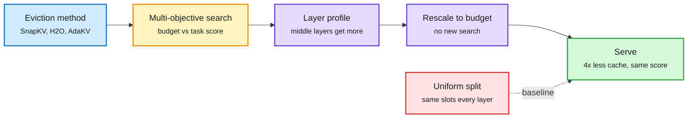

# MOSAIC: search the per-layer KV-cache budget instead of splitting it evenly

**Source:** arXiv [2610.25431](https://arxiv.org/abs/2610.25431) (Kodavanti, Arveti), Kurate cs.LG weekly #1 (2026-10-25, scores still placeholders) · raw: `raw/kurate/2026-10-25-cs-lg.md`
**Topic:** KV cache, token eviction, budget allocation

## TL;DR

Token-eviction methods (SnapKV, H2O, AdaKV, L2Norm) decide *which* tokens to keep but give every layer the same number of slots. MOSAIC runs one multi-objective architecture search over per-layer budgets, mapping the trade-off between average budget and task score. The best allocation transfers to any target budget without a new search. Across four eviction methods on Llama-3-8B-Instruct and Mistral-7B-Instruct-v0.2 it beats uniform allocation in 146 of 154 settings, by up to +48 points on RULER and +11.9 on LongBench LCC, and matches uniform quality with up to 4x less cache. Learned allocations consistently favour a small set of middle layers.

The eviction policy picks tokens; MOSAIC picks how many each layer gets

One offline search, then the same layer profile is rescaled to any budget.

Blue is the existing eviction method, amber is the search, purple is the learned profile, green is the result, red is the uniform baseline.

## Key findings

- 146/154 wins over uniform allocation across task x method x budget; up to +48 RULER, +11.9 LongBench LCC.
- Uniform-quality scores at up to 75% smaller cache on both models.
- Versus EvolKV (evolutionary per-layer search): a ~10^40x larger search space, 4x fewer evaluations, 18% fewer GPU-hours per budget, higher score in 5 of 6 settings.
- One search covers all budgets: the allocation *shape* transfers; an optional budget-constrained search refines it.
- Middle layers get the budget. Early and late layers tolerate aggressive eviction.

## Relation to prior wiki pages

- **Extends** the [KV cache](kv-cache.md) "selection beats compression" pattern (n=6 by 10-22): MOSAIC is selection at the layer axis rather than the token axis, and it composes with any token selector.
- **Fills the gap** flagged in the 10-24 digest's Looking Ahead, which listed MOSAIC as a Kurate pick not yet on HF.
- **Agrees** with prior layer-heterogeneity results (head- and layer-adaptive budgets such as AdaKV and PyramidKV) but replaces hand-designed pyramids with a searched profile; the "middle layers matter" finding contradicts the classic pyramid assumption that early layers need the most.
- **Open:** only 7-8B dense models with standard attention. Untested on GQA/MLA-heavy frontier models, on hybrids where most layers hold a fixed state ([PACE](2026-10-23-pace-four-bit-recurrent-states.md)), and with paged serving engines where uneven per-layer budgets complicate block allocation.

## Research angle

Does the learned profile correlate with a cheap proxy (attention entropy, retrieval-head density) so it can be predicted without search? And does the profile shift under KV quantization, where the MiniMax 10-23 disclosure showed 4-bit KV hides sub-task regressions?
