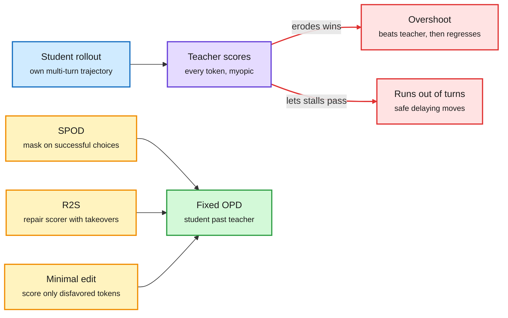

# Agentic on-policy distillation: overshoot, a myopic scorer, and minimal edits

**Sources:** DAIR Academy AI Papers of the Week (Oct 19-25), captured in `raw/dair/2026-10-25-213702-dair-academy.md`
- [Beyond the Teacher: distillation overshoot / SPOD (2610.25034)](https://arxiv.org/abs/2610.25034), USC, Florida, Emory
- [Capable Teacher, Myopic Scorer: R2S (2610.28586)](https://arxiv.org/abs/2610.28586), NVIDIA
- [Edit, Don't Imitate: minimal-edit OPD (2610.30231)](https://arxiv.org/abs/2610.30231), Meta Superintelligence Labs
**Topic:** knowledge distillation, on-policy distillation (OPD) for agents and small VLMs

## TL;DR

Three papers from one DAIR week attack the same weakness. In on-policy distillation (OPD: the student generates its own trajectories and a stronger teacher scores every token), the teacher's per-token scores are a poor guide in multi-turn agent tasks. **SPOD** finds that a weak student first beats its teacher and then regresses, because OPD erodes the student's own successful choices whenever the teacher disagrees; masking teacher supervision on successful choices and adding a soft probability floor lifts final success by up to 15.2 points and beats the teacher by up to 20.0. **R2S** says the failure is not compounding error but a myopic scorer: the teacher's own takeovers finish the task from the hardest states, yet its token scores let through safe stalling moves. Fine-tuning the teacher's scores on takeover outcomes before distillation wins all 12 teacher-student-environment cells, by 12.8 success points on average. **Minimal-edit OPD** lets the teacher score only the tokens it would change in a wrong rollout, with privileged figure descriptions available only in training; the student then matches the base model that is handed the description at test time, and a frozen same-size teacher still works.

Three fixes to the same weak link: the teacher's token score

Each paper changes what the score is allowed to touch, not the student or the data.

Blue is the student's rollout, purple is the teacher score, red is the two failure modes, amber is each paper's fix, green is the result.

## Key findings

**SPOD (distillation overshoot).**
- Two competing effects: OPD repairs weak student decisions and erodes successful ones the teacher disfavors. Repair dominates early, erosion later.
- Fix needs only binary episode success and probabilities already computed: mask conflicting teacher supervision on successful choices, add a soft probability floor.
- Up to +15.2 points final success over OPD, up to +20.0 over the teacher. Final SPOD checkpoints beat OPD's *best intermediate* checkpoint in all six settings, so this is not early stopping.

**R2S (Rollout-to-Scorer Distillation).**
- "Rollout-scorer gap": what the teacher does (its takeovers succeed) differs from what it scores (token scores do not penalize stalling, which outcome RL would score zero).
- Mine high-disagreement states from the untrained student, run teacher takeovers, keep states where enough takeovers pass a reward-free check (consensus or LLM judge), fine-tune the teacher to give takeover-informed scores from the divergence turn onward.
- No task reward at any stage. Beats three state-of-the-art agentic OPD methods in 12 of 12 cells, +12.8 success points on average.

**Minimal-edit OPD (multimodal reasoning).**
- Small VLMs fail visual math by misreading the diagram, then reason correctly from false premises.
- Teacher sees the reference figure description and a verified solution, scores wrong rollouts under a minimal-edit objective; only teacher-disfavored tokens enter the loss; correct rollouts get task-reward RL.
- The student without a description matches or beats the base model given the description. Gains largest on low-level geometric perception. A frozen same-size teacher works because it only judges corrections.

## Relation to prior wiki pages

- **Confirms the selective-supervision pattern.** The [knowledge-distillation concept page](knowledge-distillation.md) has tracked "selective supervision beats uniform supervision" since TIP (04-16, most teacher tokens carry no signal) through Semi-OPD and BranchOPD (10-13/10-14). Minimal-edit OPD is the purest version yet: the loss touches only tokens the teacher would change.
- **Extends Gains and Collapse (10-09)**, which reframed OPD as RL with the teacher's log-probs as an implicit reward that can misalign. R2S names the specific misalignment in agents (no penalty for stalling) and repairs the reward itself, rather than masking bad responses.
- **Explains a 09-30 scaling result.** Scaling Properties of Same-Family OPD found that in every weak-to-strong pair the student's *peak* beats its teacher. SPOD gives the mechanism (repair minus erosion) and a way to keep the peak.
- **Contradicts the compounding-error framing** behind PivotOPD (10-08, fix one early turn) and CriticOPD (10-16, restore teacher recoverability on wrong prefixes). R2S shows the teacher is still reliable from the student's worst states; the problem is the score, not the state distribution. Whether these are complementary or competing is open.
- **Compression angle:** minimal-edit OPD with a same-size frozen teacher means a small model can be improved without a bigger teacher, which removes the dominant cost of distillation.

## Open questions

- None of the three compares against the others; SPOD's mask and R2S's scorer repair could stack.
- R2S's reward-free check (consensus, LLM judge) is itself a scorer that could be myopic on longer horizons.
- Minimal-edit OPD is shown on visual math only; does the "score only the edit" idea transfer to agentic tool-use rollouts?

Related: [knowledge-distillation](knowledge-distillation.md) · [AsyncOPSD (10-25)](2026-10-25-async-opsd.md) · [Semi-OPD (10-13)](2026-10-13-semi-opd-and-when-on-policy-distillation-fails.md) · [OPD teacher-as-reward (10-09)](2026-10-09-opd-teacher-as-reward-cluster.md)
