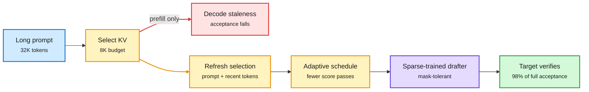

# RIFT: KV compression for draft models goes stale as the output grows

**Source:** [RIFT: KV Cache Compression for Draft Models with Complementary Compressibility Training (2610.31098)](https://arxiv.org/abs/2610.31098), Tsur, Zilberstein and colleagues (NVIDIA). DAIR pick, Oct 24 ([page](https://academy.dair.ai/papers/rift-kv-cache-compression-for-draft-models-with-complementary-compressibility-tr-2610.31098)); listed in DAIR's weekly top papers on [X](https://x.com/dair_ai/status/2114391255765352836). Raw: `raw/dair/2026-10-25-213702-dair-academy.md`
**Topic:** KV cache compression, speculative decoding

## TL;DR

In speculative decoding a small draft model guesses several tokens and the big target model checks them in one pass. On long contexts the drafter's own KV cache (the stored attention keys and values for every past token) becomes a real cost, so people compress it by keeping only the prompt tokens that score as most important. NVIDIA's team shows this goes wrong over long outputs. They call it **decode staleness**: the selection is made at prefill, and the longer the answer gets, the less those prompt tokens matter, so the drafter's guesses get worse and fewer are accepted. RIFT has two parts. First, it keeps a mix of prompt tokens and recently generated tokens, and **refreshes the selection during decoding**, on an adaptive schedule that limits how often scores are recomputed. Second, a **compressibility training** phase fine-tunes the drafter with sparse attention masks so it is accurate when it only sees part of its cache. Together, Qwen3.5-4B drafting for Qwen3.5-122B keeps over 98% of its full-cache acceptance length on 32K-token inputs and 4K-token outputs with an 8K-token KV budget.

The drafter's kept tokens must move with the answer

Prefill-only selection goes stale; RIFT re-selects during decode and trains the drafter for a sparse cache.

Blue is the prompt, amber is the cache selection and refresh, purple is the drafter, green is the verified result, red is the failure mode of prefill-only selection.

## Key points

- **Decode staleness is new as a named failure.** Selection-based eviction (SnapKV-style: score prompt tokens once, keep the top ones) was designed for prompt-heavy, short-output tasks. Long reasoning outputs break the assumption.
- **Refresh has a latency price.** Re-scoring during decode adds work; the adaptive schedule reduces score calculations while keeping drafter quality.
- **Training and compression are complementary.** The drafter can be taught to tolerate a sparse cache, which matters because a drafter is small and cheap to fine-tune.
- **Gaps:** one model family (Qwen3.5), one budget headline; no end-to-end wall-clock speedup number in the abstract, and no comparison to drafters that drop their own KV history.

## Relation to prior wiki pages

- **Same week as MOSAIC (10-25)**, which searched per-layer KV budgets and matched uniform eviction with 4x less cache. MOSAIC asks *how much* each layer keeps; RIFT asks *when* the selection must change. Both say a static, uniform eviction policy leaves quality on the table.
- **Contrasts DLite (10-20)**, which drops the drafter's own KV history in multi-turn agents. RIFT keeps a compressed history and refreshes it. Which wins depends on output length; no head-to-head yet.
- **Fits the "acceptance length decides" thread on the [speculative-decoding page](speculative-decoding.md)** (10-23: DFlash2 keeps ~1.4x at high concurrency because 4-7 tokens are accepted). RIFT protects acceptance length as context grows, the regime where drafting usually collapses.
- **Agentic and reasoning outputs are long,** so decode staleness likely affects every reasoning-model deployment that uses prefill-time eviction on the target model too, not just drafters. That is the obvious follow-up.

Related: [kv-cache](kv-cache.md) · [speculative-decoding](speculative-decoding.md) · [MOSAIC (10-25)](2026-10-25-mosaic-per-layer-kv-budgets.md) · [DLite (10-20)](2026-10-20-speculative-drafting-dlite-ready-flashmap.md)
