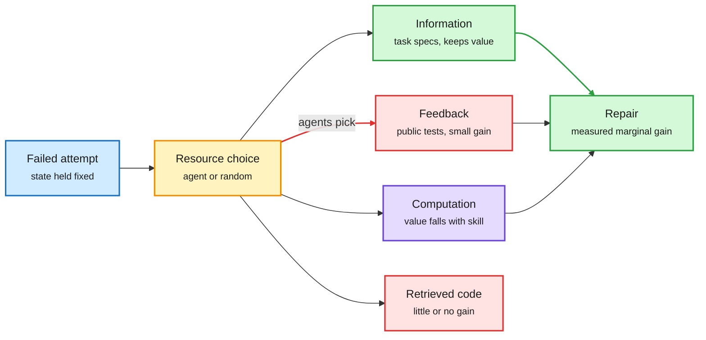

# Where a stuck agent should spend its next tokens, and teaching agents a budget

**Sources:** DAIR Academy AI Papers of the Week (Oct 19-25), `raw/dair/2026-10-25-213702-dair-academy.md`
- [Where Should a Stuck Agent Spend Its Next Tokens? Banzhaf Resource Attribution (2610.28834)](https://arxiv.org/abs/2610.28834), UBC, Toronto, Tulane, Rutgers
- [Rewards for Budget-Aware Multi-Turn Agents (2610.28409)](https://arxiv.org/abs/2610.28409), Oxford and Apple
**Topic:** test-time compute allocation, agent routing of resources

## TL;DR

Inference-time scaling is usually framed as "how many more tokens." **Banzhaf Resource Attribution (BRA)** treats a failed coding agent's retry as a choice among three kinds of resource: more computation, more information (task specs, retrieved code) and more feedback (public test results). It toggles each one in a factorial design while holding the failed state and the revision protocol fixed, across six models, 194 function-level failures (MBPP+, HumanEval+) and 126 SWE-bench Verified failures. Task-relevant specifications help consistently. Test feedback helps a little. Retrieved code helps almost nothing. The value of extra computation *falls* as the model gets stronger, while information keeps its value. The sharpest result: three of four frontier models choose feedback in 95-100% of cases and gain less than picking a resource uniformly at random. The **budget-aware rewards** paper asks whether an agent can learn to spend a user-stated budget itself. Qwen3.5 4B and 9B agents on AppWorld (budgets on tokens, API calls, environment steps) and BabyAI (turn budgets) learn this with overspend penalties, generalize to unseen budget values and zero-shot to a new benchmark. Eleven reward objectives are compared: a sigmoid overspend penalty gives the best within-budget success, a fixed negative reward the best compliance.

The agent picks feedback; the gain is in information

BRA holds the failure fixed and toggles each resource to measure its marginal value.

Blue is the failure, amber is the allocation decision, green is the resource that pays and the result, red is what agents over-pick or what does not help.

## Key findings

- **Information beats compute for strong models.** The marginal value of extra computation declines with capability; specifications stay useful. Most channels show diminishing returns, but complementary information can compound.
- **Agents misallocate.** Frontier models default to feedback 95-100% of the time and underperform random selection. The allocation decision itself is the weak link, not the resources.
- **Budgets can be learned, not only enforced.** Overspend penalties teach a single policy to scale its resource use to the stated budget and to task difficulty. Combining frequency and magnitude penalties gives the smallest average gap to the best reward at each budget.
- **Limits:** BRA covers coding repair only (one retry). The budget paper trains one policy per environment and resource type, so a single agent juggling token, API and step budgets at once is untested.

## Relation to prior wiki pages

- **Extends the [test-time compute allocation](test-time-compute-allocation.md) thread.** CLEAR (06-05) rationed compute across a batch with one shadow price, and ATEST (10-22) priced it live by GPU energy. Both assumed the resource is more tokens. BRA shows the resource type matters more than the amount, which makes this a routing problem over resource channels.
- **Confirms Vals AI (10-12)**: teams add little once a solo agent runs at max effort, so more compute is a substitute, not a complement. BRA gives the same shape at the single-retry level.
- **Pairs with SWE-Verifier (10-24, a 4B model chooses which coding steps get extra sampling, under 4% of steps).** Both say a small learned allocator beats the frontier model's own instinct about where to spend.
- **Connects to the agent-memory reading tax (10-24 routing digest)** and Naive RAG (10-23): retrieved code helping little is the same lesson as "complex memory is often not needed."

## Research angle

A learned resource router for repair (choose spec vs tests vs compute per failure) is the obvious follow-up; BRA's Banzhaf values are training labels for it. Whether the budget-aware reward also fixes the "always pick feedback" bias is untested.

Related: [test-time-compute-allocation](test-time-compute-allocation.md) · [llm-routing](../ai-routing/llm-routing.md) · [ATEST (10-22)](2026-10-22-atest-and-implicit-budgeting.md) · [CLEAR (06-05)](2026-06-05-clear-shadow-price-reasoning-budget.md)
