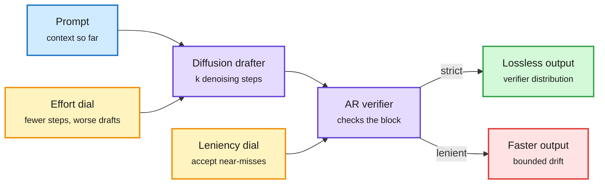

# Speculative diffusion is a tale of two tradeoffs (plus Unlimited-OCR 2's fixed-size attention)

**Date:** 2026-10-27 · **Sources:** [Speculative Diffusion is a Tale of Two Tradeoffs (2610.31819)](https://arxiv.org/abs/2610.31819), HuggingFace 10-26 · [Unlimited-OCR 2](https://huggingface.co/baidu/Unlimited-OCR-2) (Baidu, lab watcher 10-27)
**Raw:** `raw/huggingface/2026-10-26-speculative-diffusion-*.md`, `raw/labs/2026-10-27-103558-labs.md`

## TL;DR

Speculative decoding is normally lossless: a fast draft model proposes tokens and the big verifier accepts or rejects them, so outputs match the verifier's distribution. Diffusion LLMs make a different trade: fewer denoising steps buy speed at a quality cost. Diffusion models make attractive drafters because they emit many tokens in parallel. This paper treats both knobs at once: **diffusion effort** (denoising steps in the drafter) and **acceptance leniency** (how far the verifier lets accepted tokens drift from its own distribution). Jointly varying them extends the speed-quality Pareto frontier beyond single-step diffusion drafting. The point is conceptual: once you allow a lossy verifier, the drafter's effort and the verifier's strictness are one budget, not two.

Two dials, one speed-quality budget

The drafter spends steps, the verifier spends strictness; the frontier moves only when both move.

Blue is input, purple are the two models, amber are the two dials, green is the exact output, red is the lossy fast path.

## Gaps

The abstract gives no speedup numbers, model sizes or serving setting. No result under batched load, which the wiki's 10-22 EAGLE-4 table showed is where drafting gains collapse (DSpark and DFlash 2 fall below plain decoding at 512 requests).

## Unlimited-OCR 2: a fixed-size attention working set

Baidu's Unlimited-OCR 2 adds **Sparse Reference Sliding Window Attention (SR-SWA)**: text-visual attention over very long documents is compressed into a fixed set of working references (for example 512 tokens). Per-step decode latency and memory stay nearly constant as documents grow, and the SGLang path reuses the KV tail of the previous page window. It reports SOTA on MPDocBench and the hundred-page MarathonDocBench. It is a production example of the bounded-KV pattern the [kv-cache](kv-cache.md) page tracks.

## Relation to prior wiki

- **Extends** the diffusion-drafter line (DScout 10-22, Lafa 10-22, flow-map drafters 10-25) by naming leniency as a second axis.
- **Tension:** RIFT (10-26) and the EAGLE-4 load results optimize acceptance length losslessly. This paper argues the lossless constraint is itself a tunable cost. Whether lossy acceptance is acceptable in production is unresolved.
- Concept pages: [speculative-decoding](speculative-decoding.md), [kv-cache](kv-cache.md).
