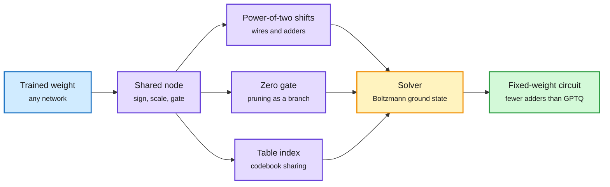

# TWIG: every weight is a path of shared discrete decisions

**Date:** 2026-10-27 · **Source:** [Every Weight Is a Path of Shared Discrete Decisions (2610.31931)](https://arxiv.org/abs/2610.31931), HuggingFace daily papers 10-26 (19 upvotes)
**Raw:** `raw/huggingface/2026-10-26-every-weight-is-a-path-*.md`

## TL;DR

TWIG (Tree-structured Weights with Inherited Gates) writes every weight as the leaf of a path of small discrete decisions: a sign, a shift by a power of two, a zero gate, an index into a shared table. Weights that belong together share the top of their paths, so each shared decision is stored once and applied once. Three consequences follow. Any trained network can be rewritten as a TWIG. Pruning, quantization, low-rank factorization, codebooks and weight sharing all become edits of one object, so one optimizer could choose among them for a whole network. And picking the decisions is the ground-state problem of a higher-order Boltzmann machine, the problem class annealers and quantum optimizers target. Every common format (group scales, shared exponents, microexponents, sparsity) is a shallow TWIG at no extra cost. On five LLM weight matrices, a flat tree of signed power-of-two terms, chosen per weight for circuit cost and with no group scales, needs **9-15% fewer additions than GPTQ at equal layer error at 3 and 4 bits**, and **20-55% fewer on matrices with strong outliers**.

One tree replaces five compression formats

Shared decisions sit high in the tree, so they are stored and applied once.

Blue is the input network, purple is the tree of decisions, amber is the single solver, green is the hardware output.

## Key points

- **The cost metric is adders, not bits.** The headline compares circuit cost (number of additions for a hard-wired weight layer) at equal layer error. That is the right metric for chips whose weights are fixed at fabrication, not for GPU serving where memory bandwidth dominates.
- **Unification is the real claim.** Today each compression method has its own format and solver. TWIG makes "prune this, quantize that, share this codebook" one search problem.
- **Outliers are where it wins most** (20-55% fewer additions), consistent with the wiki's month-long "protect the fragile slice" thread (PACE 10-23, LIRQuant 10-25).

## Gaps

Five weight matrices, layer error only. No end-to-end perplexity, no full-model result, no GPU kernel, no annealer run. The Boltzmann-machine framing is a mapping, not a demonstrated solver advantage.

## Relation to prior wiki

- **Extends** the format trend the [quantization](quantization.md) page tracks (MX microexponents, NVFP4 group scales) to its limit: shared decisions all the way down.
- **Connects** to the 10-20 frozen 16 MB vocabulary (sign codes as weights) and to fixed-weight inference silicon in [hardware](../hardware/memory-hierarchy.md).
- Concept pages: [quantization](quantization.md), [model-pruning-sparsity](model-pruning-sparsity.md).
