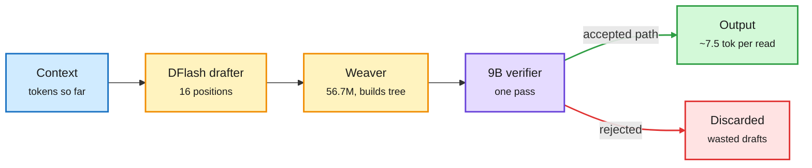

# Local decode past the bandwidth wall: uzu, LFM3, Ling-3.1, DGX Spark MoE

**TL;DR.** Local decoding reads every weight once per token, so a 5.2 GB 4-bit 9B model on a 153 GB/s base M5 caps near 29 tok/s. **uzu** (trymirai, Apple-silicon engine) runs Qwen3.5 9B at 92 tok/s versus 22 for llama.cpp and 25 for MLX: a DFlash drafter proposes 16 positions at once, a 56.7M Weaver adapter turns them into a tree of branches, and the 9B verifies the tree in one pass, averaging ~7.5 accepted tokens per weight read. **LFM3 (Liquid AI)**: ~2B open models (text, vision, audio, omni) on one backbone; the 1.7B text model has 24 layers, of which 13 are short convolutions, 5 sliding-window attention (256 tokens) and only 6 global attention, so only 6 layers grow a KV cache; 256K context; vendor-run WebArena-Verified 38.4 vs 28.9 for Qwen3.5-9B. GGUF/MLX/ONNX quants shipped same day. **Ling-3.1-flash-1019 (inclusionAI)**: 560B MoE, 25B active (8 of 512 experts), 63 KDA linear-attention layers to 9 Gated MLA layers (7:1), 1M context, FP8, MIT. **NVIDIA on DGX Spark**: for Ling-3.0-flash (124B, 5.1B active) at batch 1, a Humming MoE kernel (-9.3% time per token), online FP8 LM head (halved its weight reads, +21.7% combined) and built-in MTP speculation (3.90 accepted tokens/round, +185% on synthetic) give +42.5% decode on GSM8K with no detectable accuracy change. **SingProbe**: an 8M probe on three hidden layers of GLM-5.3-Flash scores intent, unsafety and hallucination per token at under 0.5% decode overhead.

One weight read, 7.5 tokens out

The big model checks a whole tree of guesses per pass.

Blue is input, amber is cheap drafting, purple is the main model, green is kept output, red is rejected drafts.

## Relation to prior wiki pages
- [Speculative decoding](speculative-decoding.md): load-aware drafting (10-22 Looking Ahead) matters for servers; on a single-user laptop batch is 1, so the deepest tree wins. uzu is the extreme of that regime.
- [KV cache](kv-cache.md): LFM3 and Ling-3.1 are two more "only a few layers pay the cache bill" hybrids, after PACE (10-23) argued the recurrent state is the cache in such models.

Sources: [uzu](https://github.com/trymirai/uzu) · [LFM3](https://huggingface.co/collections/LiquidAI/lfm3) · [Ling-3.1](https://huggingface.co/inclusionAI/Ling-3.1-flash-1019) · [NVIDIA DGX Spark MoE](https://developer.nvidia.com/blog/3-ways-to-boost-moe-inference-on-nvidia-dgx-spark/) · [SingProbe](https://huggingface.co/inclusionAI/GLM-5.3-Flash-singprobe) · raw: [labs 18:11](../../raw/labs/2026-10-27-181156-labs.md), [labs 23:09](../../raw/labs/2026-10-27-230938-labs.md)
