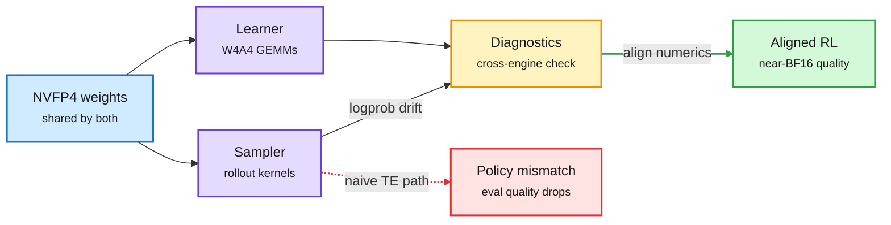

# miniTE: native NVFP4 RL needs matching execution, not just matching weights (2610.23928)

**TL;DR.** RL for LLMs runs two engines: a sampler (vLLM/SGLang-style) that generates rollouts and a learner that computes gradients. Going to NVFP4 (NVIDIA's 4-bit float on Blackwell) in both is attractive, but the paper shows that matching weights and number formats is not enough: the two engines execute the 4-bit math differently, so the learner evaluates a slightly different policy than the one that sampled. miniTE adds execution diagnostics, cross-engine numerical alignment, and its own native W4A4 GEMM kernels, without changing the RL objective. Long-horizon RL on Qwen3-30B-A3B trains stably and lands close to BF16, beating naive Transformer Engine NVFP4 on evals. On one B300 node the learner hits 33,540 tokens/s, 1.39x BF16 and 1.47x TE NVFP4 for full learner updates.

The mismatch is in execution, not in the weights

Same 4-bit weights, two kernels, two slightly different policies.

Blue is the shared weights, purple are the two engines, amber is the alignment check, green is stable training, red is the naive path.

## Key findings
- Train/sample numeric mismatch is a known RL instability source in BF16; at 4 bits it becomes the dominant one.
- 1.39x learner throughput over BF16 on B300, with released kernels, diagnostics and configs.

## Relation to prior wiki pages
- Extends the training-inference mismatch thread in [RL for LLMs](../llms-foundation-models/rl-for-llms.md) into the low-precision regime.
- Pairs with the bf16 Softmax Collapse result (10-24, collapse at logit margin ~5.5 in bf16): precision bugs in training show up as policy drift, not loss spikes.
- Complements MiniMax M3.1 Flash's W4A4 serving disclosure (10-23: scale placement in fused GEMMs is where bugs hide). miniTE is the training-side version of that lesson.

## Gaps
- One model family (Qwen3-30B-A3B MoE) on one node; multi-node scaling and dense models untested.

Raw: [HF](../../raw/huggingface/2026-10-27-minite-diagnosing-and-bridging-the-execution-gap-in-native-n.md) · [arXiv](https://arxiv.org/abs/2610.23928)
