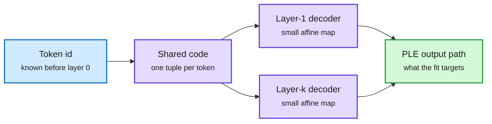

# OPTIC: 100x compression of per-layer embeddings (2610.31309)

**TL;DR.** Per-layer embeddings (PLE: a separate embedding vector per token *per layer*, used in Gemma's on-device E-series) are 35.2% of Gemma 4 E4B's parameters. At extreme compression, giving each token-layer vector its own few-byte code fails. OPTIC (Output-Path-fitted, Token-shared Indexed Codes) stores one quantized code tuple per token and decodes it at every layer with a small layer-specific affine decoder. Codes and decoders are fitted to the PLE output path, not to the stored vectors. At about 100x PLE compression it keeps 97.8% of the uncompressed model's performance across seven benchmarks (product quantization, the best of six baselines: 66.3%). At 594x and 1,002x it keeps 90.5% and 84.1%. On the official W4A16 release it keeps 96.9% at ~100x. GPU memory drops 29.7% at the same KV size, with at most 0.40% slowdown.

One code per token, decoded differently at every layer

Cross-layer sharing is where the 100x comes from.

Blue is the token address, purple are the shared code and per-layer decoders, green is the fitted target.

## Relation to prior wiki pages
- Third compression result for token-ID-addressed tables in a week on [conditional memory embeddings](conditional-memory-embeddings.md): Conditional Program (10-22, 2-bit codes for Engram n-gram tables, 203 GB to 51 GB) and DeepSeek's Engram prefetch (10-22). OPTIC is the "compress it into HBM" route at a far higher ratio, exploiting cross-layer redundancy instead of per-row codes.
- Like RAQ-MLA (today), the fit targets the output path, not tensor reconstruction.

## Gaps
- Gemma 4 E4B only. Whether larger PLE-style tables (or Engram tables) share as much cross-layer structure is open.

Raw: [HF](../../raw/huggingface/2026-10-27-extreme-compression-of-per-layer-embeddings-via-cross-layer.md) · [arXiv](https://arxiv.org/abs/2610.31309)
