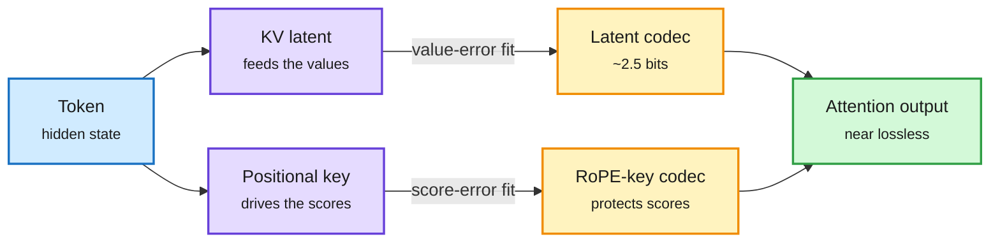

# RAQ-MLA: quantize the MLA cache by what each tensor does (2610.33625)

**TL;DR.** MLA (multi-head latent attention, DeepSeek's design) caches one compressed latent per token plus a narrow positional key, not per-head keys and values. Standard KV-cache quantizers assume K and V and lose accuracy at low bits on MLA. RAQ-MLA shows the two cached tensors play different roles: the latent mainly supplies values, while the positional key dominates the attention score. It fits an invertible transform per tensor against the error that tensor actually delivers to the attention output (attention-weighted value error for the latent, score perturbation for the positional key). Training-free, it quantizes the whole MLA cache to about 2.5 bits per element, a 6.5x capacity gain, nearly lossless on reasoning and coding across four MLA models. Kurate cs.AI #8 this week (ai_rating 6.5); not on HF.

Two cached tensors, two different error budgets

Each tensor is fitted against the damage it does downstream, not its own reconstruction error.

Blue is input, purple are the two cached tensors, amber are the role-specific codecs, green is the attention result.

## Key findings
- Error should be measured at the attention output, per tensor role, not as tensor MSE.
- ~2.5 bits/element across the full MLA cache, 6.5x theoretical capacity, no training.

## Relation to prior wiki pages
- [KV cache](kv-cache.md) selection work (MOSAIC 10-25 per-layer budgets, RIFT 10-26 decode-time refresh) picks *which* entries to keep. RAQ-MLA is the bits axis for the architecture most frontier MoEs now use. The 10-25 open question "nobody has searched tokens, layers and bits jointly" now has an MLA-native bits component.
- Same "measure the error where it lands" logic as ThinkBit's reasoning-test selection (today) and PACE's error-lifetime argument (10-23).

## Gaps
- Abstract-level only (no alphaxiv overview yet). No fused-kernel decode latency; capacity gain is theoretical.
- Long-context (128K+) and agentic tasks not named in the abstract.

Raw: [Kurate cs.AI](../../raw/kurate/2026-10-28-cs-ai.md) · [arXiv](https://arxiv.org/abs/2610.33625)
