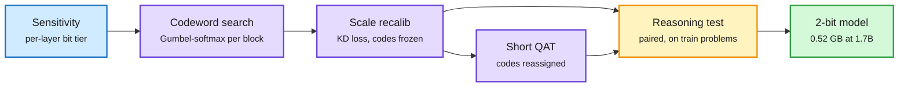

# ThinkBit: 2-bit weights that still reason (2610.34886)

**TL;DR.** ThinkBit is a strictly scalar 2-bit quantization pipeline judged on reasoning, not perplexity. Every weight is an integer codeword times a bf16 group scale. A sensitivity metric gives each layer a ternary, 2-bit or 3-bit tier; a Gumbel-softmax search picks codewords block by block; scales are then recalibrated with codewords frozen against a distillation loss; a short QAT (quantization-aware training) pass on reasoning traces lets codewords move; and a paired reasoning test on training problems picks the final checkpoint. On Qwen3-1.7B the recalibrated checkpoint scores 46.7 on MATH-500 versus 30.0 for EfficientQAT on the same data, and 73.0 after QAT, at 0.52 GB (smaller than every published 2-bit GGUF of that model). At 14B, a 3.74 GB model scores 94.8 on MATH-500 against 97.5 for the 29.5 GB bf16 model.

Four stages, and the last one is a reasoning test

Perplexity never decides anything; a paired MATH check picks the checkpoint.

Blue is the bit allocation, purple are the fitting stages, amber is the selection gate, green is the shipped model.

## Key findings
- Strictly scalar codes (no vector codebooks) keep the format kernel-friendly: dequant is one integer times one scale.
- Recalibrating scales alone, with codewords frozen, recovers most of the gap (30.0 to 46.7 on MATH-500 at 1.7B). QAT on reasoning traces then lifts it to 73.0.
- Mixed ternary / 2 / 3-bit tiers by layer sensitivity matter more than any single-format trick.
- Scales to 14B: 3.74 GB, 94.8 vs 97.5 MATH-500.

## Relation to prior wiki pages
- **Extends the "protect the fragile slice" pattern** in [quantization](quantization.md): LIRQuant (10-25, learnable rotation only on sensitive channels) and PACE (10-23, 8-bit only for long-memory heads). ThinkBit applies the same idea at layer granularity.
- **Answers the evaluation complaint** raised by MiniMax's KV4 disclosure (10-23, averages hid a 6.6-point slice drop): ThinkBit's whole design rests on reasoning-specific checks.
- **Contrasts with TWIG (10-27)**, which unifies formats into one decision tree. ThinkBit is the opposite bet: one dumb scalar format, smarter fitting.

## Gaps
- Math-heavy evaluation (MATH-500). Code and long-horizon agent tasks untested.
- No kernel throughput numbers; the 8x bandwidth saving is theoretical.

Raw: [HF](../../raw/huggingface/2026-10-27-thinkbit-search-codewords-recalibrate-scales-select-by-reaso.md) · [arXiv](https://arxiv.org/abs/2610.34886)
