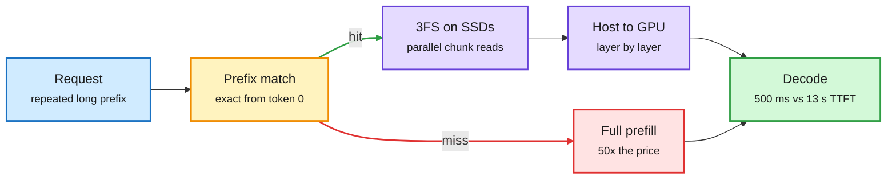

# KV cache on disk (DeepInfer) and cache engineering for agents (AKV)

**Sources:** X feed 2026-10-28: [@_avichawla on DeepSeek DeepInfer](https://x.com/_avichawla/status/2115400590960599112) (the day's most-shared KV-cache post), [@TheTuringPost on AKV / cache engineering](https://x.com/TheTuringPost/status/2115426701769642018) (Tsinghua + CUHK), [@navaneethvb on CUDA Graph padding](https://x.com/navaneethvb/status/2115434455775031807). raw: `raw/twitter/feed/2026-10-28-*-ranked.json`, `raw/twitter/feed/2026-10-29-morning-ranked.json`.

**TL;DR.** Two posts reframe the KV cache (the stored keys and values for every prior token, which lets a model skip re-reading the prompt) as a storage-system object. DeepSeek open-sourced **DeepInfer**, the stack behind its prefix-cache hits: because MLA (multi-head latent attention, which stores one small compressed vector per token per layer) shrinks the cache by ~93%, the cache can live on SSDs in DeepSeek's 3FS distributed file system, read from thousands of drives in parallel and streamed to the GPU layer by layer while the model runs. A cached 128K prompt returns its first token in 500 ms instead of 13 s; 56% of a day's input tokens were once served from disk; prefixes are kept 3 days for agent traffic and 7 for chat; a hit is priced 50x below a miss. **AKV** (Tsinghua and CUHK) argues agents should do "cache engineering" instead of context trimming: keep the text history, but add `drop` (remove KV entries from future attention) and `repos` (re-index positions of retained keys) operations, so trimming never forces a recompute. A simple drop-old-tool-outputs policy gave 27.7% lower cost, +1.7 benchmark points, 1.18x throughput and 1.51x better P95 latency.

Small cache plus wide storage makes disk faster than recompute

MLA shrinks each token's cache; 3FS reads it from thousands of SSDs at once.

Blue is the request, amber is the prefix lookup, purple is the disk path, green is the fast result, red is the expensive miss.

## CUDA Graph padding (practitioner note)
CUDA Graphs replay a captured kernel sequence to avoid CPU launch overhead, but they need fixed shapes. vLLM captures graphs for preset token counts (e.g. 8, 16, 32, 64, 120, 128) and pads to the next one, so a 121-token batch pays for 128. Cost follows a staircase, and adding one token can jump cost noticeably. vLLM's Adaptive Verification work (DSpark confidence-scheduled verification) cites exactly this case. Lesson for speculative decoding: verification batch sizes should be chosen to land on captured graph sizes.

## Relation to prior wiki
- **Confirms** the 10-28 RAQ-MLA thread (a 2.5-bit MLA cache quantizer giving 6.5x capacity): MLA's small cache is what makes tiered storage possible, and quantizing it further would make disk hits cheaper still.
- **Answers** the 10-23 open question in [KV cache](kv-cache.md) about pricing prefix-cache loss in routers: DeepSeek's 50x hit/miss price ratio is now a public number any router can use.
- **AKV vs the memory tax (10-28)**: the memory-tax paper found agent-memory systems that rewrite history drop facts and cost more than plain retrieval. AKV keeps the full text and only edits attention visibility, which sidesteps that failure.
- **Production link**: Cloudflare's KV isolation leak (10-28) shows the risk side: once caches are shared, persistent and multi-tenant, they are security state.
