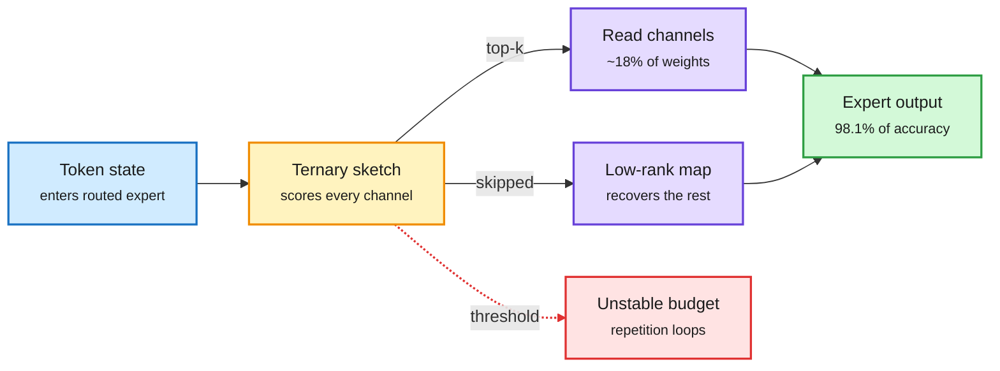

# Channel selection for MoE decoding needs no calibration data

**Source:** [arXiv 2610.37386](https://arxiv.org/abs/2610.37386) · HuggingFace daily papers 2026-10-28 · raw: `raw/huggingface/2026-10-28-channel-selection-for-mixture-of-experts-decoding-needs-no-c.md`

**TL;DR.** At batch one, a MoE (mixture-of-experts) model's decode speed is set by how many routed-expert weight bytes it reads per token. Channel selectors skip the intermediate channels of each expert that contribute little to the current token. The usual recipe keeps channels above a threshold calibrated offline. This paper shows the threshold buys nothing: it does not fix the read budget (a selector calibrated for 18% reads only 12.9% on average), and per-token top-k on the same score matches or beats it in 40 of 43 comparisons, with no calibration data at all. The authors then build a reader entirely from the model's own weights: a ternary sketch screens channels, and a low-rank map recovers the contribution of skipped ones. It keeps 98.1% of full accuracy at 17.8% of routed-expert reads, and its Triton kernels run MoE blocks 1.60-1.90x faster than optimized vLLM at batch one (up to 2.69x at larger batches).

Read fewer expert channels, decided per token

A weight-only sketch picks the channels; a low-rank map patches what was skipped.

Blue is input, amber is the selector, purple are the two read paths, green is output, red is the calibrated-threshold failure mode.

## Key findings
- Calibrated thresholds do not control the read budget: the number of channels passing a fixed threshold varies by input (Prox calibrated for 18% reads 12.9%).
- Top-k on the same score matches or beats threshold in 40 of 43 comparisons at 13% and 18% budgets, including all 23 generation tasks.
- Thresholds cause repetition-loop collapse on Gemma 4; top-k does not.
- Weight-only reader: 98.1% of full accuracy at 17.8% of routed-expert reads across three post-trained MoEs; 1.60-1.90x MoE-block speedup over vLLM at batch 1.

## Relation to prior wiki
- **Extends** the "protect the fragile part" thread in [model pruning and sparsity](model-pruning-sparsity.md): ThinkBit (10-28) allocated bits per layer by sensitivity; this allocates reads per token by contribution.
- **Complements** [quantization](quantization.md): channel skipping and low-bit weights both cut bytes per token and should compose, but nobody has tested them together.
- **Fits** the bandwidth framing from the 10-28 uzu/local-decode note: at batch 1 the only levers are fewer bytes per token or more tokens per read. This is the "fewer bytes" lever inside MoE experts.

## Open questions
- Does the low-rank recovery map survive 4-bit expert weights, or does quantization noise swamp it?
- At large batch, different tokens want different channels, so the union read grows. The 2.69x at larger batch suggests it holds, but the crossover batch size is not reported.
