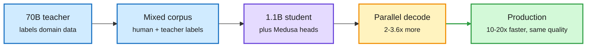

# Two production efficiency recipes: distillation plus Medusa at Booking.com, and FP32 on Tensor Cores (BF16x9 / TF32x3)

**Sources:** [Amazon Science: Speeding up language models for travel applications](https://www.amazon.science/blog/speeding-up-language-models-for-travel-applications) · [NVIDIA Developer: Unlocking Tensor Core Performance for MLIPs](https://developer.nvidia.com/blog/unlocking-tensor-core-performance-for-machine-learning-interatomic-potentials/) · [Bonsai 2 thread](https://x.com/Oluwaphilemon1/status/2115961874479018293) · [Nanbeige4.3 per-layer GGUF](https://x.com/0bserver/status/2115785308545417451). raw: `raw/labs/2026-10-29-230224-labs.md`, `raw/twitter/feed/2026-10-30-evening-ranked.json`.

**TL;DR.** Two lab posts on 10-29 show efficiency work that is already shipping rather than proposed. (1) AWS and Booking.com combined knowledge distillation (a 70B Llama-3.1 teacher labels domain data for a 1.1B TinyLlama student) with Medusa-2 (extra decoding heads that predict several future tokens in parallel, trained jointly with the student). Distillation alone closed more than 90% of the student-teacher gap and ran about 6x faster. Medusa heads added another 2 to 3.6x. The combined model matched the 70B teacher while running 10 to 20x faster; Smart Filters answered 15x faster for 99% of queries; accommodation descriptions got 1.4% more "helpful" ratings at under a third of GPT-4's cost. The work won the ACL Industry Track best paper. (2) NVIDIA showed FP32-accurate matrix math on Tensor Cores without retraining. BF16x9 on Blackwell splits each FP32 operand into three BF16 pieces and recombines nine products in FP32; TF32x3 on Ampere uses a leading plus residual TF32 piece and three products. On the Point Edge Transformer (an atomistic simulation model), BF16x9 sped large GEMMs 2.2 to 2.5x and the full MD step up to 1.7x, with error below the model's own nondeterminism, enabled by one cuBLAS environment variable.

Shrink the model, then let it guess ahead

Distillation buys 6x, Medusa heads multiply it again; one training stage does both.

Blue is the data side, purple is the student, amber is the multi-token decoding step, green is the deployed result.

## Key findings

- **KD + Medusa-2 (Booking.com).** Fine-tuned TinyLlama already beat few-shot GPT-4o per task; KD closed >90% of the remaining gap to the 70B teacher; Medusa-1 (frozen base, separate heads) and Medusa-2 (single stage) gave comparable speedups, and Medusa-2's simpler pipeline won for teams managing many models.
- **BF16x9 (Blackwell).** `CUBLAS_EMULATE_SINGLE_PRECISION=1` routes SGEMMs to Tensor Cores. Performant mode: 1.2x MD step at 192 atoms, 1.7x at 17,280 atoms. No model-code change.
- **TF32x3 (Ampere).** CUTLASS `OpMultiplyAddFastF32`: 1.7 to 1.9x on major GEMMs, up to 1.5x per MD step, energy conservation preserved; one-pass TF32 drifted and failed a 539-atom relaxation that TF32x3 finished in about 220 steps.
- **Practitioner compression, same day.** PrismML reports Bonsai 2 (ternary weights, values in {-1, 0, +1} plus scales) shrinks Qwen3.8-27B from 55.6 GB to 5.9 GB keeping 98.2% aggregate score over 20 benchmarks, up from ~95% for Bonsai 1 (self-reported, not independently checked). Nanbeige4.3-33B ships as an 11.6 GB per-layer mixed GGUF at +3.8% perplexity vs +14% for a uniform IQ2_S of the same size.

## How it relates to prior wiki pages

- **Confirms** the [speculative decoding](speculative-decoding.md) thread that multi-token heads compose with compression rather than competing with it. It is a production counterpart to the many 2026 papers on draft heads.
- **Extends** [knowledge distillation](knowledge-distillation.md): an older, off-policy KD recipe still delivers near-teacher quality when the task is narrow. The on-policy OPD papers of October target general reasoning, where this would not suffice.
- **BF16x9** is the inverse of the 10-28 miniTE finding (4-bit RL fails from sampler/learner execution mismatch): here the numerics are emulated *up* to FP32 to avoid exactly that kind of drift, and the speedup comes from Tensor Core throughput, not fewer bits. See [GPU kernels](../hardware/gpu-kernels.md).
- **Per-layer quant** confirms the 10-28 state of knowledge in [quantization](quantization.md): allocate precision by downstream damage, not uniformly.

## Related

[Quantization](quantization.md) · [Speculative decoding](speculative-decoding.md) · [GPU kernels](../hardware/gpu-kernels.md)
