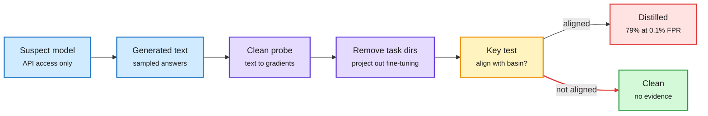

# Watermark Basins: catching distilled models through their weights, from the API alone

**Sources:** [arXiv 2610.37266](https://arxiv.org/abs/2610.37266) (Meta FAIR / Meta Superintelligence Labs; via [@dair_ai](https://x.com/dair_ai/status/2115808882434158851), [@rohanpaul_ai](https://x.com/rohanpaul_ai/status/2116078904662462729), [DAIR Academy](https://academy.dair.ai/papers/watermark-basins-black-box-detection-of-distilled-llms-2610.37266)) · context: [The Decoder on Astra as distillation target](https://the-decoder.com/openais-astra-becomes-the-main-target-for-chinese-ai-labs-after-anthropic-tightens-its-defenses/), [Kimi K3.1 Pro report](https://x.com/VaibhavSisinty/status/2115803342903624003). raw: `raw/twitter/feed/2026-10-30-evening-ranked.json`, `raw/rss/2026-10-29-the-decoder-openai-s-astra-becomes-the-main-target-for-chinese-ai-l.md`.

**TL;DR.** API distillation (training a student on a teacher's outputs) is the cheapest way to copy frontier capability. Labs can watermark their outputs, but existing black-box detectors look for the watermark in the student's *text*, using token statistics. That signal vanishes when the distillation traces were sampled at low temperature. WM-Basin finds a more durable trace: fine-tuning on watermarked traces writes a key-specific direction into the student's *parameters*, orthogonal to the ordinary task fine-tuning subspace. The detector never sees the weights. It queries the suspect model, maps its generated text to gradients of a fixed clean probe model, projects out the task directions, and tests whether the residual aligns with the basin induced by the watermark key. At a 0.1% false-positive rate it flags 79% of distilled students at n-gram=1 (45% at n-gram=3) against 29% for the best token-level test. The signal survives quantization, pruning and RL post-training, for students from 135M to 8.2B parameters distilled on math reasoning.

The watermark hides in the weights, and gradients bring it back out

Only API text is needed; the clean probe model turns text into a direction you can test.

Blue is what the detector can see, purple is the gradient machinery, amber is the decision, red flags a copy.

## Key findings

- The watermark basin is a key-specific geometric signal in parameter space, orthogonal to task fine-tuning directions, so it persists when token-level radioactivity is gone.
- 79% detection at 0.1% FPR (n-gram=1) vs 29% for the strongest token-level detector.
- Robust to quantization, pruning and RL post-training. Student sizes 135M to 8.2B.

## Gaps

- Evaluated on math-reasoning distillation only. Frontier-scale students (Kimi K3.1 Pro is reported at 2.8T parameters) are three orders of magnitude larger than the largest student tested.
- Requires the teacher to have watermarked outputs at harvest time. It cannot prove distillation from unwatermarked traffic after the fact.
- Mixed-teacher distillation (a student trained on several labs' outputs) is not reported.

## How it relates to prior wiki pages

- **Industry collision.** On 10-29 The Information and The Decoder reported that Chinese labs shifted harvesting to GPT-6 Astra after Anthropic's defenses cut Claude harvest 90-99%; today Reuters (citing The Information) reported Kimi K3.1 Pro and DeepSeek V4.1-Flash 1017 benefited from Astra distillation. WM-Basin is the first published tool that could turn such reports into evidence, if OpenAI watermarks Astra outputs.
- **Robustness to compression** links this to [quantization](quantization.md) and [pruning](model-pruning-sparsity.md): the basin survives exactly the post-processing a copier would apply.
- See [knowledge distillation](knowledge-distillation.md) for the on-policy distillation thread; this is the adversarial face of the same technique.

## Related

[Knowledge distillation](knowledge-distillation.md) · [Responsible AI](../responsible-ai/responsible-ai.md)
