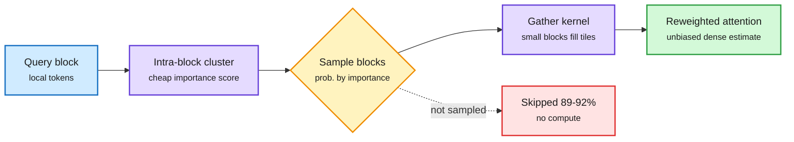

# AB-Attention: accurate block-sparse attention for video diffusion (2026-10-31)

**Source:** HuggingFace Daily Papers, 2026-10-30 · [arXiv 2610.39663](https://arxiv.org/abs/2610.39663) · raw: `raw/huggingface/2026-10-30-ab-attention-accurate-block-attention-for-accelerating-video.md`

## TL;DR

Video diffusion transformers spend most inference time in 3D full attention. Dynamic block-sparse attention computes exact attention only on selected key/value blocks, but fidelity collapses at high sparsity for three reasons: block scores come from coarse summaries, pruned blocks simply vanish from the softmax (biasing it), and whole tensor-core tiles are kept or dropped even when only a few keys inside matter. AB-Attention fixes each: (1) an Intra-Block Clustering Selector clusters queries only within each query block, so importance estimates are faithful without permuting tokens; (2) blocks are sampled in proportion to importance and reweighted by inverse inclusion probability, so one pass is an unbiased estimate of dense attention rather than a truncation; (3) the kernel gathers KV blocks smaller than a tile into full tensor-core tiles, refining selection at no extra tensor-core cost. On Wan2.1 and HunyuanVideo it skips 89-92% of attention (baselines compute 1.8-3.6x as much), gains up to 4.4 dB PSNR over the strongest baseline, and reaches 2.23x end-to-end speedup. Training-free.

Sample blocks, do not just drop them

Inverse-probability weights turn sparse attention into an estimate of dense attention.

Blue is input, purple the scoring and kernel, amber the sampling decision, green the output, red the skipped work.

## Gaps

Video DiTs only (bidirectional attention, no KV cache). Whether importance sampling helps causal LLM decode, where sparse attention fights a memory-bound KV read, is untested. Variance of the estimator at very low sample counts is not reported in the abstract.

## Relation to prior wiki

- **Extends** [gpu-kernels](../hardware/gpu-kernels.md) and [attention-mechanisms](../llms-foundation-models/attention-mechanisms.md): the tile-granularity mismatch (selection wants small blocks, tensor cores want big tiles) is the same constraint the 10-29 CUDA Graph padding note hit for verify batches (121 tokens pay for 128).
- The sampling-plus-reweighting idea is the statistical fix for the softmax bias of top-k sparse attention that the wiki's sparse-attention and KV-eviction entries in [kv-cache](kv-cache.md) have treated as unavoidable.
