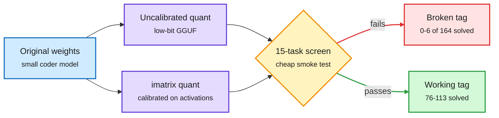

# Broken on Arrival: non-functional quantized LLMs in public registries (2026-10-31)

**Source:** HuggingFace Daily Papers, 2026-10-30 · [arXiv 2609.05881](https://arxiv.org/abs/2609.05881) · raw: `raw/huggingface/2026-10-30-broken-on-arrival-non-functional-quantized-llm-artifacts-in.md`

## TL;DR

An audit of every eligible code-capable GGUF tag (llama.cpp's quantized file format) in the official Ollama library: 305 tags across 15 model lines, plus 22 popular Hugging Face community files. A 15-task code screen flagged suspects, retested on all 164 HumanEval+ tasks. Seven official tags (2.3%) solved six or fewer. All seven were low-bit quants of models at or under 4B parameters. Rebuilding five suspects from the original weights reproduced the registry files tensor for tensor, so nothing was corrupted: the recipe itself produced broken models. Holding weights, toolchain and tensor mix fixed, adding an importance matrix (imatrix: a calibration pass that weights quantization error by how much each weight matters on real activations) lifted three Qwen2.5-Coder-3B builds from 0 to 76-113 solved tasks. The same uncalibrated recipe left Qwen2.5-Coder-1.5B working, so the recipe alone does not predict failure. None of 66 sampled tags that passed the screen were broken. Released: audit data and a `quantcheck` tool.

Reproducible is not the same as working

The registry file matched a clean rebuild exactly and still solved nothing; calibration was the fix.

Blue is the source model, purple is a quant recipe, amber is the screen, green is a working file, red is a broken one.

## Key findings

- 2.3% of official code-capable Ollama tags are functionally dead; failures cluster at low bit-width and small (≤4B) models, where each weight carries more of the function.
- Tensor-exact reproducibility does not imply function. Registry hygiene (checksums, provenance) cannot catch this; only a functional test can.
- imatrix calibration is the decisive variable in the failing cases.
- No registry examined documented functional testing.

## Gaps

Code tasks only; no chat, math or long-context screens. No explanation of which tensors drive collapse. Only GGUF/llama.cpp; no AWQ, EXL2 or NVFP4 artifacts audited.

## Relation to prior wiki

- **Confirms** the [quantization](quantization.md) frame that quantizers must be judged on downstream damage, not reconstruction error (four papers on 10-29 fit quantizers against task damage). This is the registry-scale version of that point.
- **Tension** with the 10-30 Bonsai 2 claim (ternary Qwen3.8-27B at 5.9 GB keeping 98.2% aggregate, self-reported): aggregate retention numbers hide per-task collapse, and this audit shows collapse can be total at small scale.
- Same day: NVIDIA's DeepSeek-V4.1-Flash NVFP4 card states "lossless weight conversion does not imply" unchanged behavior and publishes task evals ([Nemotron/NVFP4 summary](../llms-foundation-models/2026-10-31-nemotron-35-report-and-4bit-serving.md)), the publisher-side practice this paper asks for.
