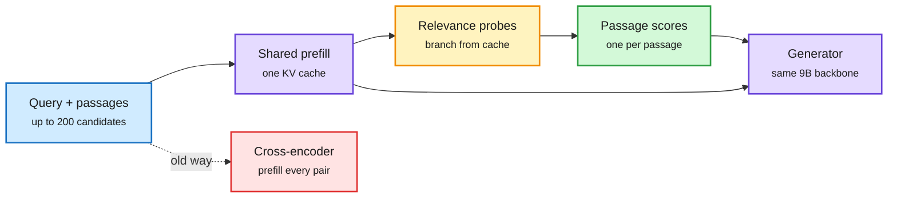

# Glance and the cache economics of agents (2026-10-31)

**Sources:** HuggingFace Daily Papers 2026-10-30 · [Glance, arXiv 2610.40454](https://arxiv.org/abs/2610.40454) · Arena (LMArena) Agent Arena analysis via X: [thread](https://x.com/arena/status/2116186548588929328), [article](https://x.com/arena/status/2116185149918626145)

## TL;DR

Two views of the same fact: once a context is prefilled into the KV cache (the stored attention keys and values for every processed token), reusing it is far cheaper than redoing it.

**Glance (paper).** RAG pipelines usually serve a separate reranker model (a cross-encoder that scores each query-passage pair) next to the generator, duplicating model residency and passage processing. Glance adds a small decision adapter and pointer head to the generator itself. All candidate passages are prefilled once; short relevance probes branch from that cached context and emit one score per passage, with no per-pair prefill. One resident 9B backbone does generation, reranking and other decisions at ~0.1 GiB extra per decision skill. After 39 minutes of MS MARCO fine-tuning: nDCG@10 0.741 on SciFact and 0.345 on NFCorpus vs 0.721 and 0.326 for bge-reranker-v2-m3. Answer F1 on 300 HotpotQA questions +0.045 over cross-encoder context (95% CI [0.014, 0.076]). Quality keeps rising up to 200 candidates (43K tokens) from one prefill, +0.058 nDCG@10 over the cross-encoder, and a probe-only adapter lets generation continue from the original passage cache.

**Arena (industry data).** 26K+ Agent Arena sessions (Sept 12 to Oct 23), 30 agents, 13 labs. If cached tokens were billed at full input price, a top-10 agent task would cost 3.6x (260% more). A typical Claude Fable 5.1 task: $7.44 with caching, ~$27 without. One cache invalidation (for example a coffee break past expiry) adds ~5% to a typical task. Context: OpenAI just moved to 12-hour API prompt caching and non-expiring caches in Codex and Work, so cache lifetime is now a price lever.

Prefill once, decide many times

Glance's probes branch off the cache instead of re-reading every passage.

Blue is input, purple the shared model and cache, amber the probes, green the scores, red the duplicated old path.

## Gaps

Glance: one backbone family, two retrieval sets, one QA set (the authors say so). No latency comparison under concurrent load. Arena: a counterfactual billing exercise, not measured spend; it ignores that without caches providers would price input differently.

## Relation to prior wiki

- **Confirms** the [kv-cache](kv-cache.md) shift recorded on 10-29/10-30: the cache is now a storage tier (DeepSeek's DeepInfer: disk-tier cache hits priced 50x below misses) and a scheduling signal (TAO: place agent sessions where their cache lives, up to -36.3% TTFT). Glance makes it a *decision* substrate too.
- **Routing angle** ([llm-routing](../ai-routing/llm-routing.md)): reranking is routing over passages. Like GAVEL (09-16, skill routing inside a frozen LLM), Glance folds the router into the generator.
