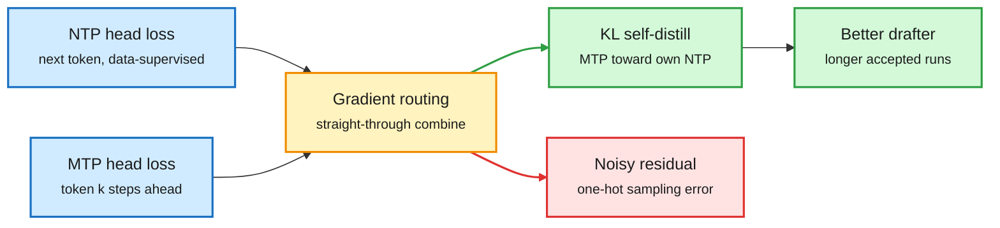

# Soft-MTP: Multi-Token Prediction Done Right (2026-10-31)

**Source:** HuggingFace Daily Papers, 2026-10-30 · [arXiv 2610.38331](https://arxiv.org/abs/2610.38331) · [code](https://github.com/JaydenTeoh/Soft-MTP) · raw: `raw/huggingface/2026-10-30-multi-token-prediction-done-right.md`

## TL;DR

Multi-token prediction (MTP: extra heads that predict tokens two or more steps ahead, later reused as speculative-decoding drafters) is standard in DeepSeek- and Meta-style pretraining. Jayden Teoh (MIT) shows the MTP cross-entropy gradient splits exactly into two parts: a KL self-distillation term that pulls each MTP head toward the model's own next-token distribution (useful, and exactly what speculative decoding wants), plus a residual driven by one-hot sampling noise that has low signal-to-noise and grows more harmful with scale. The "KL gradient-recovery trick" keeps only the KL part by combining the existing NTP and MTP cross-entropy gradients through straight-through routing over the shared output head. No vocabulary-sized logit matrix is built, fused CE kernels still work, and the change is one line. From 167M to 1.2B, Soft-MTP gives lower NTP perplexity, faster speculative decoding and higher zero-shot accuracy at every scale, matching or beating direct KL minimization.

Keep the half of the MTP gradient that helps drafting

The noisy residual is dropped; the KL signal is rebuilt from losses you already compute.

Blue is the existing losses, amber is the new routing step, green is the kept signal, red is the dropped residual.

## Key findings

- Exact decomposition: MTP CE gradient = KL(MTP head ‖ NTP distribution) gradient + an NTP-error residual. The residual's noise does not shrink as the NTP model improves, so its relative harm grows with scale.
- The trick needs a shared linear output head (true for DeepSeek and Meta MTP). No new parameters, no measurable overhead.
- Gains at every tested scale (167M to 1.2B): lower NTP perplexity, faster speculative decoding, higher zero-shot accuracy; lower MTP perplexity from 689M; stronger math/code after fine-tuning at 1.2B.

## Gaps

Largest model is 1.2B. Frontier MTP users (DeepSeek V4.x, Nemotron 3.5) train at 100B+ total parameters, where the paper predicts the effect is largest but does not show it. Acceptance-length gains are not compared against post-hoc MTP boosting like Nemotron 3.5's (+21.8% acceptance length).

## Relation to prior wiki

- **Extends** the [speculative-decoding](speculative-decoding.md) thread: the 10-28 uzu/Weaver result (a tree adapter on a DFlash parallel drafter reaching ~7.5 accepted tokens per pass) improved drafting at inference; Soft-MTP improves the drafter at pretraining time. Both target agreement with the target model, not data likelihood.
- **Confirms** the [knowledge-distillation](knowledge-distillation.md) pattern that self-distillation toward the model's own distribution is the useful signal (the same day's WISD paper builds a self-teacher by weakening the model; see [WISD](2026-10-31-wisd-weakening-self-distillation.md)).
- Same-day neighbor: [Nemotron 3.5 report](../llms-foundation-models/2026-10-31-nemotron-35-report-and-4bit-serving.md) uses post-training "MTP boosting" for the same goal.
