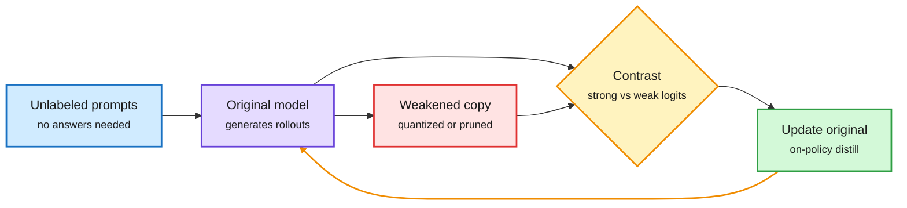

# WISD: weaken the model to strengthen it (2026-10-31)

**Source:** HuggingFace Daily Papers, 2026-10-30 · [arXiv 2610.38681](https://arxiv.org/abs/2610.38681) · raw: `raw/huggingface/2026-10-30-weaken-to-strengthen-weakening-induced-on-policy-self-distil.md`

## TL;DR

Self-distillation usually builds a stronger "self-teacher" by giving the model privileged information (the answer, a hint, a verified trace). WISD (Weakening-Induced On-Policy Self-Distillation) goes the other way: build a weaker copy of the model by low-bit quantization or magnitude pruning, and train the original on the contrast between the two on its own rollouts. No labels or privileged information needed, only unlabeled prompts. Average gains over the base models: +4.0 points with quantization as the weakener, +5.5 with pruning. Pruning lifts Qwen3.5-4B from 57.7% to 70.5% on HMMT 2025 and 39.1% to 56.7% on LiveCodeBench v6. Quantization lifts Qwen3.6-35B-A3B from 68.5% to 74.6% and 61.8% to 69.5% on the same benchmarks.

Compression as a teacher, not a cost

The broken copy tells the model which of its own behaviors are fragile.

Blue is input, purple is the model, red is the deliberately degraded copy, amber is the contrast, green is the update loop.

## Key findings

- Pruning is a better weakener than quantization on average (+5.5 vs +4.0).
- Works on dense (4B) and MoE (35B-A3B) models, math and code.
- The idea resembles contrastive decoding (amplify where the strong model differs from a weak one), moved from inference into training.

## Gaps

The abstract does not say how weak the copy should be, or whether gains survive when the weakened copy is too close (no contrast) or too far (noise). No non-verifiable domains. No comparison against privileged-information self-distillation at equal compute.

## Relation to prior wiki

- **New direction for** [knowledge-distillation](knowledge-distillation.md): the wiki's on-policy distillation thread (TIP 04-16, which found most teacher tokens carry no signal; the 05-14 Extrapolation Cliff, a threshold above which on-policy distillation collapses) always assumed a stronger teacher. WISD shows a weaker one works.
- **Inverts** [quantization](quantization.md) and [model-pruning-sparsity](model-pruning-sparsity.md): the damage that [Broken on Arrival](2026-10-31-broken-on-arrival-quantized-artifacts.md) documents as a deployment failure becomes the training signal here. Where a low-bit copy breaks is exactly the information WISD uses.
- Same-day sibling: [Soft-MTP](2026-10-31-soft-mtp-kl-gradient-recovery.md), another self-distillation result toward the model's own distribution.
