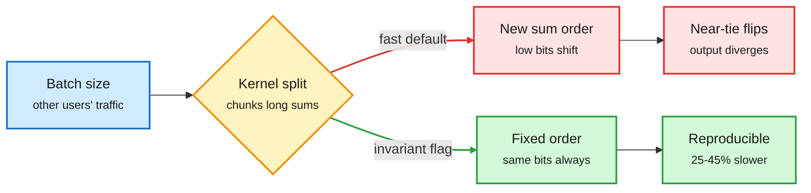

# Efficiency shorts, 2026-11-01: batch invariance's price, compressed speech tokens, two-step image distillation, any-order AR, retrieval heads

**Date:** 2026-11-01 · **Sources:** X thread by [@_avichawla](https://x.com/_avichawla/status/2116505679691407710) (batch invariance); HuggingFace Daily Papers 2026-10-30, captured late: [CoSTA 2610.21143](https://arxiv.org/abs/2610.21143), [Intrinsic Distribution Matching 2610.39633](https://arxiv.org/abs/2610.39633), [Any-order AR 2610.39293](https://arxiv.org/abs/2610.39293), [MLLM retrieval heads 2610.32411](https://arxiv.org/abs/2610.32411), [SpecSlot / Read-Allocate-Route 2610.40647](https://arxiv.org/abs/2610.40647) · **Raw:** `raw/huggingface/2026-10-30-*.md`, `raw/twitter/feed/2026-10-31-evening-233002-ranked.json`

## TL;DR

A quiet Sunday window with five efficiency items. The common thread: each one finds a place where the system was paying for generality it did not use, whether a flexible kernel split, a fine speech-token grid, many denoising steps, a fixed generation order, or all attention heads.

Who else is in your batch changes your answer

At temperature 0 the sampler is deterministic; the reduction order inside the forward pass is not.

Blue is the input you do not control, amber is the kernel's choice, red is the divergent path, green is the deterministic path and its cost.

## Items

- **Batch invariance has a measured price.** Floating-point addition is not associative, so summation order changes low-order bits. Kernels pick how to split long reductions (matmul, RMSNorm, attention) by batch size, to keep an H100's 132 SMs busy, so batch size changes the order and the logits. When two tokens are nearly tied, greedy decoding flips and the completion diverges. vLLM (`VLLM_BATCH_INVARIANT=1`, beta), SGLang (`--enable-deterministic-inference`, a 25-45% slowdown) and DeepSeek's DeepInfer (`DEEPINFER_BATCH_INVARIANT=1`) now expose fixed-order reductions. Practical rule: enable it for evals and RL rollouts, and treat batch composition as part of the experiment.
- **CoSTA: shorter speech sequences without a new tokenizer.** Spoken dialogue models generate and synthesize in one speech-token space, so sequences are long. CoSTA adds compressed tokens to the *generation* vocabulary (mean-initialized from the tokens they replace), adapts pronunciation and dialogue, then expands deterministically back to the original tokens before the unchanged decoder. About 1.7x faster speech-token generation, lower latency, same quality, and it stacks with low-rate tokenizers.
- **Intrinsic Distribution Matching: better two-step image distillation.** Distribution matching distillation (DMD, training a one- or few-step student to match a teacher's distribution via score differences) gains an explicit constraint: match feature means and per-coordinate standard deviations, computed by the generator's own EMA copy, with no external encoder. At two network evaluations it scores 94.25% / 90.20% on Chinese / English LongText-Bench on Z-Image-Turbo 6B and Qwen-Image 20B. The day's most-upvoted HF paper (238).
- **Any-order generation without retraining from scratch.** Raster-order AR image models cannot inpaint or edit. Discrete diffusion can, but costs about 3x training compute and gives up KV caching and vLLM compatibility. This recipe adapts a *pretrained* raster model with future-aware positional embeddings and an ordering curriculum, keeping the AR serving stack.
- **Retrieval heads are under 2% of heads and shared across modalities.** Across 18 language, VL and omni checkpoints, the sparse heads that copy evidence from long context to output stay sparse when audio-visual input is added, and omni models inherit them from their backbones. Ablating them kills audio-visual retrieval and hurts document and spatial tasks. A useful prior for KV-cache eviction: the heads worth protecting are few and identifiable.
- **SpecSlot.** A pixel-space generator where only the lowest-frequency slot per patch joins global attention and higher DCT bands stay local: 2.84 better FID on ImageNet-512 at 3.9% fewer FLOPs.

## How it relates to prior wiki pages

- **Batch invariance, follow-up.** [Fused MoE on Hopper and batch invariance (10-14)](../hardware/2026-10-14-fused-moe-hopper-and-batch-invariance.md) covered vLLM's bit-exact-across-processes work; [DeepInfer (10-22)](../hardware/2026-10-22-deepinfer-and-huawei-deepseek-symbiosis.md) shipped the flag. New today is the cost figure (25-45%) and the explicit link to RL rollout reproducibility. See [gpu-kernels](../hardware/gpu-kernels.md).
- **Any-order AR** echoes the [AB-Attention (10-31)](2026-10-31-ab-attention-block-sparse-video.md) theme of keeping the existing serving stack while changing what gets computed.
- **Retrieval heads** add evidence to the [kv-cache](kv-cache.md) page's head-level eviction thread (protect retrieval heads, compress the rest).
- **IDM** belongs to the [knowledge-distillation](knowledge-distillation.md) page's few-step diffusion distillation line.
