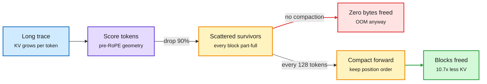

# KV cache compression and its infra problems (NVIDIA)

**Source:** NVIDIA Efficient AI blog, Weian Mao, Yukang Chen, Wei Huang, Shuai Yang, Luozhou Wang, Song Han, "KV Cache Compression and Its Infra Problems" (2026-06-12), resurfaced on X 2026-11-01 via an explainer thread
**Links:** [NVIDIA write-up](https://research.nvidia.com/labs/eai/blogs/kv-cache-compression-and-its-infra-problems/) · [thread](https://x.com/_avichawla/status/2116861920682860761)
**Raw:** `raw/twitter/feed/2026-11-01-evening-*-ranked.json` (linked-article capture)

## TL;DR

Most KV cache compression papers (methods that drop unimportant cached tokens so long generation fits in GPU memory) work in the lab and fail on a real server for two infrastructure reasons that papers rarely discuss. First, importance-based scoring needs attention scores, and FlashAttention never writes them to memory; recovering them means falling back to slow eager attention. Second, vLLM's PagedAttention stores the cache in fixed 16-slot blocks and reclaims a block only when every slot is empty. Evicting 90% of tokens by importance leaves survivors in almost every block, so almost no memory comes back. NVIDIA's TriAttention fixes both: it ranks tokens from the geometry of pre-RoPE query and key vectors (no attention scores needed) and every 128 decoded tokens compacts survivors forward so trailing blocks empty and return to the allocator, keeping the cache in position order. Reported: full-attention accuracy on long reasoning traces, 2.5x faster decoding, 10.7x less KV memory.

Eviction frees tokens, compaction frees blocks

Only the compaction step returns memory to the paged allocator.

Blue is input, purple is the scoring step, amber is cache state, red is the failure path, green is reclaimed memory.

## Key points

- **The motivating number.** Qwen3-32B at 4-bit on a 24GB GPU hits OOM around 24K generated tokens, short of the 32K traces reasoning models produce on hard problems.
- **The field's recipe.** StreamingLLM keeps attention sinks (the first few tokens that always draw attention) plus a recent window. H2O and Scissorhands keep "heavy hitters" by cumulative attention. SnapKV scores once at end of prefill from an observation window of recent queries. Because RoPE (rotary position encoding) orients each query by position, only about the last 25 queries reflect where the model is attending, so any fact that draws no attention during one phase gets evicted even if later reasoning needs it.
- **Infra problem 1: no scores.** FlashAttention computes attention tile by tile in on-chip SRAM and discards each score tile. Every score-based method needs eager attention to materialize the score matrix in HBM, which removes FlashAttention's speedup.
- **Infra problem 2: fragmentation.** Paged blocks free only when empty. Evict 14K of 16K tokens over 1,000 blocks and nearly every block still holds a survivor. Writing new tokens into the holes breaks position order, so every slot then needs a stored position index that every kernel must read.
- **Why papers miss it.** They benchmark on pre-allocated contiguous tensors, not a paged server. The metric to track is blocks freed, not tokens evicted.
- **TriAttention's fix.** Pre-RoPE queries and keys form stable clusters, so token importance can be predicted from geometry without scores. A periodic compaction pass moves survivors forward and frees whole trailing blocks.

## Relation to prior wiki pages

- **Contradiction with Random Attention (media-zone 09-08).** Salesforce/UIUC's Random Attention pins the prompt and keeps random cached positions; it beat learned scorers in 31 of 60 cells and ran 0.30 ms per eviction round against TriAttention's 1.47 ms (32-43% more tokens/s in vLLM). Its finding was that what mattered was whether the prompt was kept, not the scorer. Today's NVIDIA post argues the scorer's real problem is infrastructure, not quality. Both agree the bottleneck is not "which token is important." Neither has been measured on the other's terms (blocks freed under random vs geometric eviction). Open.
- **Extends** [MiLo mixed-precision KV blocks (09-27)](2026-09-27-milo-mixed-precision-kv-blocks.md), which also works at the block granularity of the paged allocator rather than the token.
- **Extends** the [KV cache concept page](kv-cache.md) thread on the cache as a serving and scheduling object (TAO 10-30, DeepInfer 10-29): compression only pays when the allocator and kernel agree.

## Research angle

- Block-aware eviction objectives: choose survivors to maximize freed blocks under an accuracy constraint, instead of maximizing retained attention mass.
- Does compaction interact badly with prefix caching (shared prefix blocks cannot be compacted per-request)?
- A standard "blocks freed per evicted token" metric would make compression papers comparable on production terms.
