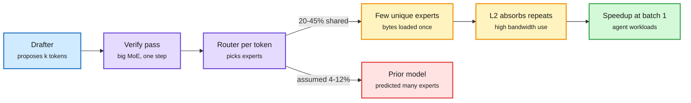

# Why Speculative Decoding Works Better Than Predicted on Sparse MoE Models

**Source:** Cohere, [arXiv:2610.38981](https://arxiv.org/abs/2610.38981), surfaced via X ([thread](https://x.com/rohanpaul_ai/status/2117365776282001748)) · raw: `raw/twitter/feed/2026-11-03-afternoon-ranked.json`

## TL;DR

Prior work predicted a concave speedup-vs-batch curve for speculative decoding on MoE models: little gain at batch 1 because each draft token activates new experts. Across 10 sparse MoEs (30B-1T parameters, 8-512 experts) profiled on H100, recent fine-grained models break the trend and show their highest speedup at low batch. Two reasons: adjacent tokens share 20-45% of their experts versus 4-12% under independent routing, and fine-grained MoE kernels use bandwidth well with L2 absorbing repeated reads of co-routed experts, so MoE layers are a smaller share of runtime than of weights. On Qwen3-235B FP8, verification ran at 89% of a decode step's speed against 52% predicted. A maximum-entropy IPF model predicts unique-expert counts from overlap statistics within 4% error.

Draft tokens reuse each other's experts

Overlap plus L2 reuse makes the verify pass cost 89% of a normal step, not 52%.

Blue is the drafter, purple is the big model, amber is the memory-side effect, red is the old assumption, green is the result.

## Relation to prior wiki pages

- Revises the MoE caveat in [speculative decoding](speculative-decoding.md): low batch is no longer the bad regime for fine-grained MoEs.
- Same mechanism as the PyTorch column-major MoE kernel (11-02, [summary](../hardware/2026-11-02-moe-column-major-kernels-and-gpu-notebook.md)): keeping expert weights resident in L2 is what makes reuse cheap. See [GPU kernels](../hardware/gpu-kernels.md).
- Matters for agent serving, where batch sizes are small and latency per step compounds.

## Open questions

- Does the overlap hold on agent traffic (tool calls, code) rather than benchmark text?
- Blackwell's larger L2 and NVFP4 kernels: does the advantage grow?
