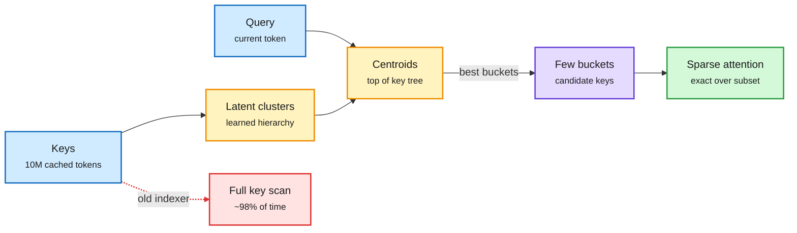

# Latent Sparse Attention: tree search over keys for 10M-token context

**Sources:** [arXiv 2610.42147, "Latent Sparse Attention: Towards Subquadratic Ultra-Long Context Attention"](https://arxiv.org/abs/2610.42147) · [code + Qwen3.8-27B distilled indexer weights](https://github.com/Prefrontal-AI/latent-sparse-attention) · surfaced on X ([@NFT_Chen](https://x.com/NFT_Chen/status/2117531091615801395), [@_avichawla](https://x.com/_avichawla/status/2117735646702010840); announced without numbers via a 11-03 repost) · raw: `raw/twitter/feed/2026-11-03-evening-210222-ranked.json`, `raw/twitter/feed/2026-11-04-afternoon-172442-ranked.json`

**TL;DR.** Sparse attention lets each query attend to a small subset of keys, but something still has to *pick* that subset. At 10M tokens the picker (the indexer) dominates: per the authors, existing sparse attention spends ~98% of its time deciding which keys to read, because the indexer itself scores every key, which is quadratic. LSA clusters keys hierarchically in a learned latent space, so a query scores cluster centroids and descends into the best few buckets, a tree search instead of a full scan. Two variants: **D-LSA** distills only a new indexer onto a frozen pre-trained model; **N-LSA** is trained natively on next-token loss. At 10M tokens, D-LSA speeds one attention layer by **22.7x prefill / 4.6x decode over GLM-5.3-Flash's own sparse attention**, and **72.4x prefill / 42.5x decode over full attention on Qwen3.8-27B**, with similar accuracy across tasks (practitioner threads report a slight RULER gain and ~9x lower end-to-end time to first token). N-LSA matches full-attention accuracy with a 1.6x per-layer training speedup at 128K. Code ships an SGLang fork and downloadable Qwen3.8-27B indexer weights.

At 10M tokens the cost is choosing keys, not reading them

LSA replaces a scan over every key with a descent through key clusters.

Blue is input, amber is the learned key hierarchy that does the selecting, purple is the selected subset, green is the attention output, red is the old quadratic indexer.

## Key points

- **Bottleneck moved:** once attention itself is sparse, selection is the quadratic term. LSA attacks the selector, not the attention math.
- **Retrofit path:** D-LSA freezes the base model and trains only the indexer by distillation, so existing long-context models (GLM-5.3-Flash, Qwen3.8-27B) can adopt it without a pre-training run.
- **Numbers are per attention layer.** The 72.4x / 42.5x figures are single-layer speedups versus full attention; end-to-end gains are smaller (practitioners quote ~9x time-to-first-token).
- **Serving:** released as an SGLang fork; prefill CUDA graphs must be disabled in the current integration.

## Gaps

- Single-layer microbenchmarks dominate the headline; full-model throughput and memory at 10M tokens on named hardware are not in the captured text.
- The KV cache itself is still 10M tokens long. LSA cuts compute and selection time, not the memory needed to hold the cache, which is the binding cost per [KV cache](kv-cache.md) and the 11-03 memory-squeeze evidence.
- Accuracy is "similar across tasks"; needle-style tasks favor clustering, while multi-hop state tracking (see today's [StateBench page](../llms-foundation-models/2026-11-04-statebench-and-linear-attention-memory.md)) is the harder test.

## Relation to prior wiki

- **Extends** the routed-attention family on [attention mechanisms](../llms-foundation-models/attention-mechanisms.md): MiTA framed efficient attention as either routing (top-k, MoE attention, DeepSeek's DSA) or compressing (linear attention). LSA is routing with a hierarchical router, the attention-side analogue of hierarchical expert routing.
- **Same lesson as** the [gpu-kernels](../hardware/gpu-kernels.md) law recorded 09-17 (VC-Attention): remove one bottleneck and the next is whatever stayed on the general path. For sparse attention, that was the indexer.
- **Complements** TTR-Compressor (10-24, block summaries as regression coefficients for block selection) and AB-Attention (10-31, unbiased importance sampling over dropped blocks): three different fixes to *which blocks to read*.

See also: [KV cache](kv-cache.md), [attention mechanisms](../llms-foundation-models/attention-mechanisms.md).
