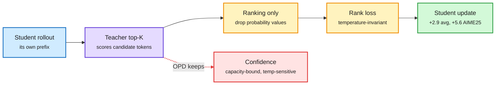

# Order-only on-policy distillation (O³PD), plus TESD and DecisionRank

**Sources:** HuggingFace Daily Papers 2026-11-03 · [O³PD, arXiv 2611.02112](https://arxiv.org/abs/2611.02112) · [TESD, arXiv 2610.38637](https://arxiv.org/abs/2610.38637) · [DecisionRank, arXiv 2610.42128](https://arxiv.org/abs/2610.42128) · raw: `raw/huggingface/2026-11-03-order-only-on-policy-distillation.md`, `...-on-policy-self-distillation-with-teacher-evolution.md`, `...-decisionrank-...md`

**TL;DR.** On-policy distillation (OPD: the student generates text and is trained to match the teacher's token probabilities on the student's own outputs) asks the student to copy two things at once. The first is *which* tokens the teacher prefers. The second is *how confident* it is. Confidence reflects the teacher's capacity and calibration, which a small student may not be able to reproduce, and it also shifts with teacher temperature. O³PD drops the confidence. At each student-generated prefix, the student learns only to reproduce the *ranking* of the teacher's top-K tokens. Across six teacher-student pairs it beats OPD on the HMMT25/AIME24/AIME25 average in every pair (up to +2.9; up to +5.6 on AIME25), with no temperature tuning. Other ranking losses give similar gains, so the benefit comes from ordinal supervision itself. The student ends up *further* from the teacher's probabilities but closer to its ranking, and stronger.

Copy the teacher's preferences, not its confidence

Same on-policy loop as OPD; only the loss target changes.

Blue is the student's own text, purple is the teacher, amber is the new loss, green is the result, red is what O³PD throws away.

## Same-day companions

- **TESD (Teacher-Evolution Self-Distillation, 2610.38637).** In on-policy *self*-distillation, the "teacher" is the same model given privileged context, and gains often stall. TESD finds the cause: the self-teacher gives unreliable guidance on some samples. It trains the self-teacher with task-correctness rewards and down-weights samples where the guidance looks unreliable. It beats token- and sequence-level baselines across datasets and scales.
- **DecisionRank (2610.42128).** OPD in *item space*. A decision-model reranker scores documents in one forward pass. Its scores are sorted into a ranking, and a generative teacher critiques that ranking. At 1.7B it beats its 27B generative teacher on TREC DL19-23. At 8B it runs 24.5x faster than its generative listwise counterpart on TREC DL. This is a latency-distillation result: decoding is removed entirely.

## Relation to prior wiki

- **Fourth paper in two weeks to change *what* the student imitates rather than *how much*.** WISD (10-31) distilled against a deliberately *weaker* copy of the model. Soft-MTP (10-31) isolated the KL term inside multi-token prediction. The Extrapolation Cliff paper (05-14) gave a closed-form threshold above which on-policy distillation collapses when the teacher-student gap is too wide. O³PD offers a cheap way to soften that gap: match ordinal structure the student *can* represent. See [knowledge distillation](knowledge-distillation.md).
- **Confirms** the TIP finding (04-16) that most of the teacher's per-token signal is not useful to the student. O³PD says the same about the probability *values*, not only about which tokens to train on.
- **Open:** tested on math reasoning only; whether rank-only targets hurt calibration-sensitive uses (routing confidence, abstention) is unmeasured, and that matters for any student used as a router.
