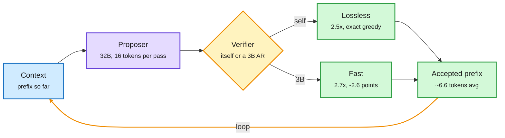

# ProVe: Proposer-Verifier decoding (speculative decoding, roles reversed)

**Source:** HuggingFace Daily Papers 2026-11-03 · [arXiv 2610.27815](https://arxiv.org/abs/2610.27815) · raw: `raw/huggingface/2026-11-03-prove-proposer-verifier-decoding.md`

**TL;DR.** Standard speculative decoding has a small model draft tokens one at a time and the big model check them in parallel. ProVe reverses this. The *large* model is fine-tuned to propose a whole block of future tokens (16) in one forward pass. One more forward pass then verifies the block. The verifier can be a small AR model (fast, slightly lossy) or the proposer itself running ordinary AR checking. The second option is ProVe-lossless, which reproduces greedy decoding exactly. On GSM8K a 16-token block has an average AR-matching prefix of 6.6 tokens. With a 32B proposer across six benchmarks, ProVe-lossless reaches 2.5x average AR throughput with no separate draft head. A 3B verifier pushes this to 2.7x at 2.6 accuracy points below AR.

The big model drafts the block, a second pass decides how much to keep

Two forward passes per step, about 6.6 accepted tokens on GSM8K.

Blue is input, purple is the fine-tuned large model, amber is the verification choice, green is accepted output.

## Key points

- **Why reversing works.** A small drafter's ceiling is its own quality: acceptance falls when the drafter disagrees with the target. A block proposed by the target itself agrees with the target far more often, so the accepted prefix is long. The cost moves from "many cheap serial draft steps" to "one expensive parallel proposal".
- **Lossless mode needs no second model.** The proposer verifies its own block with a normal AR pass, so output equals its greedy decoding. That removes drafter maintenance, a real pain point when the target is updated often.
- **A controllable dial.** A small verifier trades about 2.6 points for an extra 0.2x. That is a product decision, not a research one.

## Relation to prior wiki

- **Fits** the block-proposal family in [speculative decoding](speculative-decoding.md): MTP heads (multi-token prediction) and the 10-31 Soft-MTP result, which showed the MTP gradient is a KL self-distillation term, both make the target model draft for itself. ProVe pushes that to a full 16-token block from a fine-tuned target, with no added head.
- **Tension** with the 11-03 Cohere MoE result (adjacent tokens share 20-45% of experts, so verify passes are cheap on fine-grained MoE). ProVe was shown on a dense 32B model. On MoE, a 16-token proposal pass touches more experts. Whether the Cohere locality still holds there is untested.
- **Open:** batch-size behaviour. Block proposal costs compute, which is free at batch 1 and expensive at high batch. Serving-scale numbers are missing.

See also: [knowledge distillation](knowledge-distillation.md), [test-time compute allocation](test-time-compute-allocation.md).
