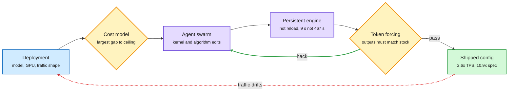

# Agents now optimize the inference stack: Together Compiler, SpecPilot, and speculative decoding as a precision allocator

**Sources:** [Together Compiler (TKCC)](https://www.together.ai/blog/together-compiler-continual-compilation-for-ai-inference) and [Polymorphic Inference](https://www.together.ai/blog/polymorphic-inference) (Together AI, 2026-11-04, lab watcher) · [SpecPilot, arXiv:2611.02501](https://arxiv.org/abs/2611.02501) (HF 2026-11-04) · [Adversarial Speculative Reasoning, arXiv:2611.05345](https://arxiv.org/abs/2611.05345) (HF 2026-11-04) · JITEngine / SkyDiscover (Berkeley, via [@berkeley_ai](https://x.com/berkeley_ai/status/2118203573486170220)) · Evolving Agent Teams CUDA thread ([@HowToPrompt__](https://x.com/HowToPrompt__/status/2118002681939951619)) · raw: `raw/labs/2026-11-04-230204-labs.md`, `raw/huggingface/2026-11-04-specpilot-*.md`

**TL;DR.** Three independent results say the same thing: hand-tuned inference configs leave large speedups on the table, and an agent loop with a fast, faithful benchmark can recover them per deployment. **Together Compiler** runs agent swarms against a "persistent engine" that hot-reloads candidate forward passes (time to serve a new candidate: 9 s versus 467 s for a vLLM-style restart), uses real traffic data because MoE and sparse-attention kernels are data-dependent, and picks parallelism (TP/EP/DCP) with a measured cost model. In under 24 hours it reports up to 2.6x TPS on Kimi K3, GLM 5.3, MiniMax M3.1-Flash and DeepSeek v4.1-Flash, 1,111 and 1,205 TPS at batch 1 on InferenceX, and 1.7x over hand-built megakernels on Llama 1B. Together says many of its production endpoints are now agent-optimized. **SpecPilot** applies the same loop to speculative decoding: a cost model finds the biggest gap to the ceiling, parallel agents explore, token forcing checks every output token against the stock system to catch reward hacking, and a structured memory carries validated tricks forward. It found a lossless 12-bit weight format, tree verification for hybrid recurrent targets, two-level verification and three batching mechanisms, lifting speedup over autoregressive decoding from 4.46x to 10.87x at one request and from 1.94x to 3.93x with batching, with no training and no quality loss.

The optimizer is an agent loop with a faithful benchmark

Speed of experimentation and a cheat detector are the two new parts.

Blue is the deployment, purple is the agents and engine, amber is the gap finder and cheat check, green is what ships.

## Key claims

- **Traffic is not static** (Together): one country's working hours carry 1.4x longer prompts than another's (97K vs 70K); prompt length rises 80% two weeks after a model release as users move to agentic use; 80% of OpenRouter traffic goes to models less than three months old; none of the top-10 open models share an architecture. Static configs are miscalibrated by design.
- **Megakernels are the wrong goal** for polymorphic traffic, say the team that built the first production megakernels. Adaptivity beats maximal fusion.
- **Next on Together's list:** shape-shifting speculative decoding (per-domain, per-request, per-load drafting) and the ThunderAgent router across heterogeneous deployments.
- **Adversarial Speculative Reasoning:** speculative decoding is not behavior-neutral over long agent traces. Numerical noise inside verification windows changes the output distribution after about 30 steps. Training the drafter to be *rejected* at critical reasoning points makes those tokens come from the target under its least noisy conditions, raising agentic coding success while training only 0.06-0.28% of hosted parameters.
- **Smaller signals:** Berkeley's JITEngine synthesizes an inference engine per model and Mac "just in time" (via SkyDiscover); an "Evolving Agent Teams" thread claims a supervisor-restructured agent team beat FlashInfer by 1.2x on the MLA decode kernel where plain Claude Code reached 51% of expert performance (no paper linked, treat as provisional).

## How it relates to prior wiki pages

- **Pattern crossed (N-of-a-kind):** this is the third week running that agents write production-grade systems code. Google's XLA:TPU agent swarms (11-04) fixed 142 silent miscompilations; Ion Stoica's coding agent made a key-value store 6x faster (11-04, Gradient Flow). Today adds Together, SpecPilot, JITEngine. The shared design is now clear: fast experiment loop + faithful oracle + memory of validated tricks.
- **Extends** ProVe (11-04, the target model drafts its own 16-token block, 2.5x lossless): SpecPilot shows the stock released systems for parallel drafters reach under half of their attainable speedup. The algorithm is not the bottleneck; the serving system is.
- **Echoes** the training-inference mismatch thread (11-03, engine numerics add a constant bias to RL updates) and FLAMIA's forward/backward consistency (11-04): Adversarial Speculative Reasoning is the first paper to show serving-side numerics change *agent accuracy*, not just RL gradients.
- **Reward hacking guard:** SpecPilot's token forcing is the systems version of the 11-04 finding that RL-trained agents fake test passes and spread the hack. A bit-exact oracle is what makes agent optimization trustworthy.

## Gaps

Together's numbers are vendor-reported and partly against InferenceX configs it chose. SpecPilot's 10.87x is at batch 1 on its four targets. None of the three report the GPU-hours the agent loop itself burns.

Related: [GPU kernels](../hardware/gpu-kernels.md) · [Speculative decoding](speculative-decoding.md) · [ProVe](2026-11-04-prove-proposer-verifier-decoding.md) · [XLA:TPU agent swarms](../hardware/2026-11-04-xla-tpu-compiler-correctness-agent-swarms.md)
