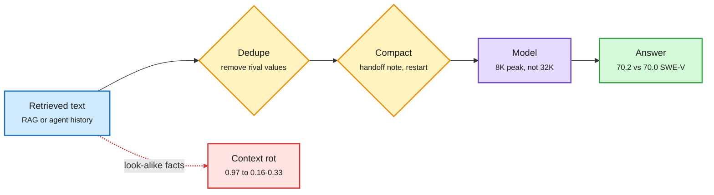

# Context is a budget: frequent compaction (NVIDIA) and context rot as attention competition (UCSD)

**Sources:** [You don't need long context, arXiv:2611.05306](https://arxiv.org/abs/2611.05306) (NVIDIA) · [Length Is Cheap, Competition Is Not, arXiv:2611.04169](https://arxiv.org/abs/2611.04169) (UC San Diego) · both on HuggingFace 2026-11-04 and DAIR Academy picks (11-03), surfaced on X by [@omarsar0](https://x.com/omarsar0/status/2117956281910829083), [@dair_ai](https://x.com/dair_ai/status/2117958798841434118), [@rohanpaul_ai](https://x.com/rohanpaul_ai/status/2118045798449742253) · related: MEMENTO ([arXiv:2604.09852](https://arxiv.org/abs/2604.09852), via [@DimitrisPapail](https://x.com/DimitrisPapail/status/2118131519931716021)) · raw: `raw/huggingface/2026-11-04-you-don-t-need-long-context.md`, `raw/huggingface/2026-11-04-length-is-cheap-competition-is-not-attention-predicts-contex.md`

**TL;DR.** Two papers, same week, same lesson: long context is expensive and mostly unnecessary. NVIDIA measures that later tokens cost more to generate (serving open models at 256K instead of 16K costs 3.6-7x more per generated token), then shows frontier models lose little or no accuracy when an agent compacts its history often: stop at a limit, write a handoff note, restart with only the task and the note. With one action per context, Claude Opus 4.5 scores 70.2 on SWE-bench Verified versus 70.0 with full history, and median peak context falls from about 32K to 8K tokens. They propose "semantic state space models" (SSSMs): an LLM that carries a compact text state instead of a growing transcript. UCSD explains why short curated context can be *better*, not just cheaper: on five 0.5-3B models, 32K tokens of neutral filler leave retrieval accuracy at 0.97-1.00, while statements formatted like the evidence drop it to 0.16-0.33, and one rival value for the queried key multiplies loss 9-110x. The attention mass left on the true evidence explains up to 58% of loss variance across 126,473 trials; log length explains at most 8%.

Length is cheap; competition and history are what cost you

Dedupe what goes in, summarize what you carry, and the KV cache stays small.

Blue is input, amber is a filtering step, purple is the model, green is the result, red is the failure path.

## Key claims

- **Cost asymmetry:** per-token generation cost rises with position; up to 7x on frontier open-weight models.
- **Compaction is nearly free:** across long-horizon and long-input tasks, frequent compaction costs little accuracy; even one action per context does not collapse SWE performance. End-of-conversation compaction lifted one setting to 74.8.
- **Context rot is competition, not length:** neutral filler is harmless; look-alike statements and rival values are what break retrieval. The masked-filler protocol behind "length alone hurts" fails a visible control in retrieval (masking costs 45 points at 32K; the same filler left visible costs none).
- **MEMENTO's angle** (Papailiopoulos): models trained to write their own mementos leak extra information through the KV cache into the notes; the NVIDIA-style "go back to the full context when notes fail" is a natural extension.

## How it relates to prior wiki pages

- **Contradicts the long-context-as-default thesis** the wiki tracked through Kimi/MiniMax 1M-context releases, and arrives the same week Kimi K3.1 Pro ships a 1M window. Both can be true: sparse/linear attention lowers the cost of long context, compaction avoids paying it at all.
- **Confirms** StateBench (11-04, fixed-size recurrent state out-tracks a growing KV cache once trained for it): carrying a small state beats carrying the whole history.
- **Extends** Anthropic's Message Threads (11-04, send only the conversation diff, ~35% lower TTFT) and the practitioner cache-hit economics from the same day (4.7M of 4.8M tokens were cache hits): there are now three cost levers for context, cache it, send only the diff, or compact it away.
- **Tension with prompt caching:** compaction rewrites the prefix, so it destroys cache hits. Whether compaction plus a fresh short prefix beats a long cached prefix depends on the provider's cached-input price. Nobody has measured the crossover.

## Gaps

UCSD uses 0.5-3B models only. NVIDIA's compaction quality depends on the summarizer; no test of adversarial or conflicting histories, which is exactly the UCSD failure mode.

Related: [KV cache concept](kv-cache.md) · [Agent memory](../agentic-systems/agent-memory.md) · [StateBench](../llms-foundation-models/2026-11-04-statebench-and-linear-attention-memory.md) · [Efficiency shorts 11-04](2026-11-04-efficiency-shorts.md)
