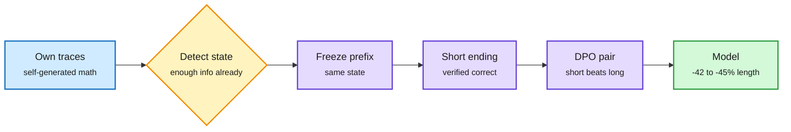

# Reasoning compression (LoCo, Concise-9B, Dory loops) and MoE training/pruning shorts

**Sources:** [LoCo, arXiv:2611.04814](https://arxiv.org/abs/2611.04814) · [Dory1.0-4B, arXiv:2611.03998](https://arxiv.org/abs/2611.03998) · [Muon and the first MoE layer, arXiv:2610.37914](https://arxiv.org/abs/2610.37914) · [What We Keep of What We Forget, arXiv:2610.41366](https://arxiv.org/abs/2610.41366) · [Near-zero token embeddings, arXiv:2611.04449](https://arxiv.org/abs/2611.04449) · [MTA-OPSD, arXiv:2610.40574](https://arxiv.org/abs/2610.40574) (all HF 2026-11-04) · Kurate cs.LG top-5: [MatMoE, arXiv:2611.01704](https://arxiv.org/abs/2611.01704), [Concise-9B, arXiv:2611.02278](https://arxiv.org/abs/2611.02278); Kurate cs.AI #2: [Twice as Fast, Until It Isn't, arXiv:2611.04380](https://arxiv.org/abs/2611.04380) · raw: `raw/huggingface/2026-11-04-*.md`, `raw/kurate/2026-11-05-cs-lg.md`

**TL;DR.** **LoCo** compresses reasoning by teaching the *local* decision to stop. It finds "overthinking states" in the model's own traces, freezes the prefix, regenerates a shorter verified ending from that same state, and trains on those state-conditioned pairs with DPO (direct preference optimization). Completion length falls 41.7-45.4% on math and 23.4-36.3% on code with equal or better accuracy. **Dory1.0-4B** spends extra compute in latent space instead of tokens: a looped nGPT whose middle block repeats a variable number of times, pretrained on 6T tokens (4.5T in NVFP4), with RLVR that routes harder prompts to deeper loops. At 2+ loops it beats Qwen3.5-9B and Gemma 4 12B on a 12-benchmark average, emits 1.3-2.5x fewer tokens on agentic tasks at 4 loops, and caches KV only from the last loop so the KV footprint equals a non-looped model. On MoE: **Muon** (the orthogonalized optimizer many open MoEs use) roughly doubles the load-balance bias span of the *first* MoE layer because its router inputs share a direction; the busiest expert ran 4-7x its fair share, and subtracting the batch mean from router inputs fixed it at no loss cost. **Training-free expert pruning** depends mostly on a detail nobody reports: whether survivors' gates are renormalized, which swings results 0.8-8.5 points and flips method rankings; a closed-form "tilted novice" replacement adds 1.2-1.8% parameters and gains 1.4-3.5 points at 50% pruning, robust to 4- and 3-bit quantization. **Near-zero embeddings:** 52.6% of untied gated/hybrid checkpoints (Mamba, Gated DeltaNet, xLSTM families) have reachable embedding rows with norm below 1e-6; such a token can amplify gradients by up to 35 orders of magnitude, overflow FP32 clipping, and silently zero about 20% of steps in a Telugu continual-pretraining run of Nemotron-3-Nano-4B.

Teach the stop decision at the state where overthinking starts

LoCo trains on local pairs, not whole shorter traces.

Blue is input, amber is the detection step, purple is pair construction, green is the compressed model.

## Other items

- **MTA-OPSD:** on-policy self-distillation where every token picks its preferred teacher from a pool of reference-conditioned teachers (majority vote plus KL selection). Up to +5.9 over base on Qwen3 math. Fifth "change what the student copies" distillation paper since 10-31.
- **TRL ships MOPD** (multi-teacher on-policy distillation: one RL expert per domain, distilled into one student) as a one-command recipe ([@SergioPaniego](https://x.com/SergioPaniego/status/2117640447174529038)).
- **Kurate-only picks** (no HF overlap this week): MatMoE (Matryoshka MoE with dynamic mixed-precision experts), Concise-9B (removing slack from a reasoning model's thinking), and "Twice as Fast, Until It Isn't" (quantized serving of mid-size open LLMs loses its 2x speedup under some load regimes). Kurate's tournament had not scored this week (all entries at the 1200 prior), so these are LLM-rated by ai_rating only.

## How it relates to prior wiki pages

- **LoCo extends** the test-time-compute allocation thread (CLEAR's shadow price, Google's finding on 11-04 that output caps do not cut thinking spend): compression must teach *when to stop*, not cap length.
- **Dory confirms** the looped-transformer page and adds the first KV-cache-neutral looping trick at 4B scale.
- **Muon result matters for Kimi K3.1 Pro** (896 experts) and every Muon-trained MoE: imbalance concentrates in layer 1.
- **Near-zero embeddings complicate** the StateBench case for recurrent layers (11-04): the gated families that track state best are the ones with this silent training failure.

Related: [Test-time compute allocation](test-time-compute-allocation.md) · [Knowledge distillation](knowledge-distillation.md) · [Pruning](model-pruning-sparsity.md) · [Looped transformers](../llms-foundation-models/looped-transformers.md)
