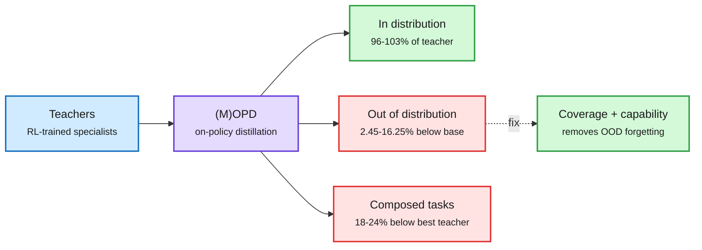

# Distillation shorts: the out-of-distribution blind spot, Muon-RT, one-step diffusion, and a shipped 60x distillation

**Sources:** [On the Generalization Limitation of OPD, arXiv:2611.05609](https://arxiv.org/abs/2611.05609) · [Muon-RT, arXiv:2610.41104](https://arxiv.org/abs/2610.41104) · [NitroFusion2, arXiv:2611.05648](https://arxiv.org/abs/2611.05648) · [VA-TDM, arXiv:2611.06796](https://arxiv.org/abs/2611.06796) · [VidDub, arXiv:2611.03404](https://arxiv.org/abs/2611.03404) · [Muse Realtime Avatar, @rohanpaul_ai](https://x.com/rohanpaul_ai/status/2118445350621171974) · raw: [raw/huggingface/](../../raw/huggingface/2026-11-05-on-the-generalization-limitation-of-on-policy-distillation-f.md)

**TL;DR.** On-policy distillation (OPD, where a student generates text and a teacher corrects it) looks near perfect on test data like its training data, and that hides a real loss. Out of distribution, students fall 2.45-16.25% below even the base model. Elsewhere, Muon-RT cuts optimizer memory by reusing the self-distillation teacher, NitroFusion2 reaches practical one-step image generation, and Meta shows the production payoff of step distillation: 120 teacher passes compressed to 2, so one GB200 runs 12 live avatar streams.

Near-perfect distillation scores can hide real forgetting

In-distribution tests pass. Extrapolation and composition expose the gap.

Blue is the input, purple is the method, green is what holds or what helps, red is what the usual scorecard misses.

## OPD's generalization limit (2611.05609)

- Tested on Qwen3 across math, coding, agent and long-context capabilities. Extrapolative in-distribution scores reach 96.04-102.73% of teachers.
- Yet the students fall 2.45-16.25% below the base model out of distribution. Multi-teacher OPD on composed tasks is 18.19-24.34% below the best teacher.
- (M)OPD still forgets less than its RL baselines, with smaller, more spectrally concentrated updates. Fixing teacher capability and data coverage together removes OOD forgetting. The authors propose geometry-based patching and base-preserving replay.

## Muon-RT (2610.41104)

An EMA teacher already stores a history of student updates, so Muon's separate momentum buffer is redundant. Muon-RT reuses the teacher-student displacement instead. On Qwen2.5-7B: +2.6 points over AdamW with 42% less persistent memory, +5.4 over momentum Muon with 27% less. On Olmo-3-7B with SDPO: +2.0 over AdamW.

## Step distillation

- **Muse Realtime Avatar (Meta):** a student reproduces in 2 passes per video chunk what a teacher built in 120. 448x768 at 25 fps, about 870 ms to reply. With 4-bit quantization, caching and dynamic batching, one GB200 runs 12 streams. At that rate 1M simultaneous callers would need about 83K GB200s for video alone.
- **NitroFusion2:** text-stream adversarial distillation takes few-step image models from 4-8 steps to 1-2 at comparable quality.
- **VA-TDM:** velocity adversarial distillation unifies score distillation, Fisher matching and moment matching under one critic-based view.
- **VidDub:** two-step video dubbing with replacement-aware supervision.

## How this relates to prior wiki pages

- **Contradicts the recent mood.** [The 11-05 shorts](2026-11-05-reasoning-compression-and-moe-shorts.md) noted MTA-OPSD and a one-command TRL multi-teacher recipe, the fifth paper since 10-31 changing what the student copies. This paper says the scoreboard those works use is incomplete.
- **Extends** [the Extrapolation Cliff (05-14)](2026-05-14-extrapolation-cliff-on-policy-distillation.md), which found a threshold above which OPD collapses. That was about the teacher-student gap; this is about what falls outside the distribution.
- **Backs** [knowledge distillation](knowledge-distillation.md) with a concrete eval change: report out-of-distribution retention against the base model.
- Dimitris Papailiopoulos's feed comment fits: "Everyone indirectly distills whether one likes it or not."

## Gaps

Qwen3 only, and the "fix" requires more teacher coverage, whose cost is not given. Meta's avatar numbers are company-run. Muon-RT is shown only on 7B models with explicit regularity assumptions behind its proof.
