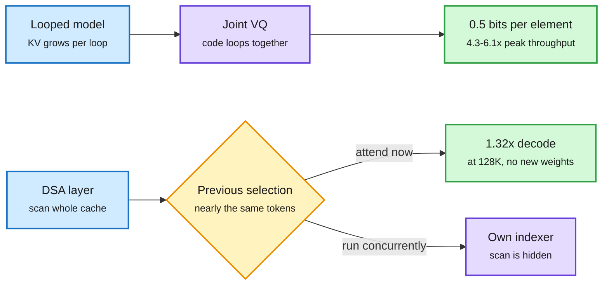

# LoopVQ and Multi-layer Indexer: two ways to shrink the long-context bill without new weights

**Sources:** [LoopVQ, arXiv:2611.05304](https://arxiv.org/abs/2611.05304) · [Multi-layer Indexer, arXiv:2611.03768](https://arxiv.org/abs/2611.03768) · raw: [LoopVQ](../../raw/huggingface/2026-11-05-loopvq-sub-1-bit-kv-cache-quantization-for-looped-transforme.md), [MLI](../../raw/huggingface/2026-11-05-multi-layer-indexer-overlapping-selection-and-attention-in-d.md)

**TL;DR.** LoopVQ compresses the KV cache of looped transformers to 0.5 bits per element by coding loop steps jointly, because the cache is highly redundant across loops. Multi-layer Indexer (MLI) fixes sparse attention's hidden cost: the indexer scan that picks tokens, not the attention it feeds, dominates long-context decode. Since adjacent layers pick nearly the same tokens, a layer can attend the previous indexer's selection and run its own indexer in parallel. Neither needs retraining the base weights.

Reuse what neighbours already computed

LoopVQ reuses across loop steps. MLI reuses across layers. Both exploit the same redundancy.

Blue is the starting cost, purple is the new mechanism, amber is the reuse decision, green is the result.

## LoopVQ

- Looped transformers reapply the same layers several times, which saves parameters but stores KV per loop step, so the cache becomes the main memory bottleneck.
- Two observations: the cache is highly redundant along the loop axis, and loop steps differ in their sensitivity to quantization.
- It codes channels from several loop steps jointly and fine-tunes codebooks to match the full-precision model's output.
- At 0.5 bits per element it beats existing KV vector quantization on general, long chain-of-thought and long-context retrieval tasks with Ouro and Huginn models. Combined with TaSQ (an existing KV quantizer), it keeps much of BF16 accuracy at 0.25 bits.
- In SGLang: decode latency nearly halved at 32K context, peak throughput up 4.3x and 6.1x on 1.4B and 2.6B Ouro models.

## Multi-layer Indexer

- In DSA (DeepSeek Sparse Attention, used by DeepSeek-V3.2 and GLM-5), a lightning indexer scans the whole cache before each layer and keeps the top 2,048 tokens. At long context that scan is where decode time goes.
- MLI removes the dependency by attending the previous indexer's selection, so each indexer runs concurrently with its layer's attention.
- It composes with IndexCache (the cross-layer reuse GLM-5.2 ships as IndexShare), which drops indexers from some layers. MLI hides the scan on the rest.
- At equal retention: up to 14.5% faster than IndexCache on DeepSeek-V3.2 and 9.8% on GLM-5 at 1/2 retention, 7.9% and 5.1% at 1/4. At 128K it reaches 1.32x the unmodified model's decode throughput at 1/4 retention, above IndexCache's 1.28x at 1/8, while keeping twice the fresh selections.
- Accuracy on LongBench, RULER and LongBench v2 stays within a few points of IndexCache. The default version changes no kernel and runs in SGLang's production decode graph.

## How this relates to prior wiki pages

- **Alternative to** [Dory1.0-4B (11-05)](2026-11-05-reasoning-compression-and-moe-shorts.md), which keeps KV only from the last loop so memory equals a non-looped model. LoopVQ keeps all loops at sub-1-bit. Which wins depends on whether earlier-loop KV carries useful signal, and nobody has tested the two head to head. This is an open contradiction.
- **Third fix to one bottleneck in a week.** [CUDA 13.5's CCCL batched Top-K (11-05)](../hardware/2026-11-05-cuda-13-5-rubin-and-midterm-compute-shock.md) targets the selection op in a library. [TPUv7's SparseCores (11-06)](../hardware/2026-11-06-tpu-ironwood-agentx-semianalysis.md) target it in hardware. MLI targets it in scheduling. The sparse indexer is now a first-class systems problem.
- **Extends** [IndexShare (09-09)](2026-09-09-next-gen-speculative-decoding-mtp-eagle2-indexshare.md) and works against the paged-allocator problem named in [the 11-02 infra write-up](2026-11-02-kv-compression-paged-infra-problems.md) only indirectly. MLI does not free memory; it only saves time.

## Gaps

LoopVQ was tested on small models (1.4B and 2.6B). MLI's accuracy cost is reported only relative to IndexCache, and it does not cover Kimi K3.1 Pro's Gated DSA. MLI's gains are modest at low retention.

**Research angle.** Both papers rest on measured redundancy between neighbours, not on a theory of how much exists. A bound on KV mutual information across layers and loops would tell you the floor for bits per element, and would decide between LoopVQ-style coding and Dory-style dropping.
