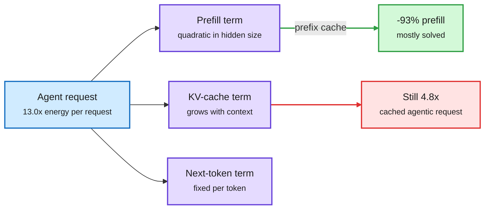

# The SIMPLE Law: a closed-form model of what an LLM token costs in energy

**Sources:** [arXiv:2611.03330](https://arxiv.org/abs/2611.03330) · raw: [../../raw/huggingface/2026-11-05-the-simple-law-for-energy-cost-of-llm-inference.md](../../raw/huggingface/2026-11-05-the-simple-law-for-energy-cost-of-llm-inference.md)

**TL;DR.** Tokens are billed the same but do not cost the same. SIMPLE derives a four-parameter law from architectural hyperparameters that splits inference energy into prefill, the KV-cache term in decode, and next-token computation. It needs no per-model fitting and reaches R2 = 0.969 and 11.97% MAPE over 13 dense LLMs on H100, 3.1-3.5x lower error than the best fitted model. Its key finding: prefix caching removes 93% of prefill energy but leaves the KV term untouched, so a fully cached agentic request still costs 4.8x a non-agentic one.

Prompt caching removes the first bill, not the second

The KV term grows with context on every generated token, and caching cannot reach it.

Blue is the request, purple is the three energy terms, green is what caching fixes, red is what it does not.

## Key findings

- Prefill energy grows quadratically with hidden dimension, so larger models suffer most from long inputs.
- More aggressive GQA (grouped-query attention, where several query heads share one KV head) cuts per-token energy by up to 3x against standard multi-head attention.
- Reasoning has an energy optimum. Accuracy rises with budget but energy rises faster, so Intelligence per Joule peaks at an intermediate budget and falls by up to 3.14x across a 4.0x reasoning-budget range.
- Agentic serving raises energy per request 13.0x. Prefill and KV terms both grow with input length.

## How this relates to prior wiki pages

- **Confirms and explains** [NVIDIA's "You don't need long context" (11-05)](2026-11-05-context-budget-compaction-and-context-rot.md), which measured 256K context costing 3.6-7x more per generated token than 16K. SIMPLE gives the mechanism and a formula.
- **Complicates** the 11-05 caution that compaction destroys prompt-cache hits. If the KV term survives caching, a long cached prefix is cheaper only on the bill, not on the energy. Cached-input discounts may be underpricing real cost.
- **Supports** [LoCo (11-05)](2026-11-05-reasoning-compression-and-moe-shorts.md), which trains models to stop reasoning once they have the answer. SIMPLE puts an energy optimum under that behavior.
- **Fits** the [roofline chapter (09-02)](../hardware/2026-09-02-physics-of-llm-inference-roofline.md), where a decode step spends nearly all its time moving bytes.

## Gaps

Only dense models on H100. No MoE, sparse attention, linear attention or quantized weights, which is what the current frontier actually serves. Energy is not dollars: GPU rental dominates cost, so the bill may be shaped differently than the joules.

**Research angle.** Extend the law to MoE plus sparse or linear attention. DSA should bound the KV read term and shift cost to the indexer scan, and KDA should nearly remove it. A published coefficient table per attention family would let routers price a request before running it.
