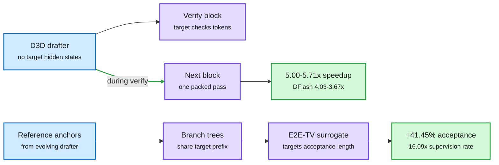

# SpecOPD and D3D: removing the sequential dependency from speculative decoding

**Sources:** [SpecOPD, arXiv:2611.02846](https://arxiv.org/abs/2611.02846) · [D3D, arXiv:2611.06425](https://arxiv.org/abs/2611.06425) · [code](https://github.com/fudan-generative-vision/D3D) · raw: [SpecOPD](../../raw/huggingface/2026-11-05-specopd-branch-parallel-on-policy-distillation-for-speculati.md), [D3D](../../raw/huggingface/2026-11-05-d3d-decoupled-diffusion-drafting-for-asynchronous-speculativ.md)

**TL;DR.** Speculative decoding lets a cheap drafter guess a block of tokens that the big model checks in parallel. Parallel drafters already generate blocks in one pass, but two steps stayed sequential. D3D removes the wait at inference: its diffusion drafter needs no target hidden states, so it can draft the next block while the current one is being verified, averaging 5.00x and 5.71x speedup on Qwen3-8B and 32B against 4.03x and 3.67x for DFlash. SpecOPD removes the wait in training: on-policy supervision does not need sequential draft-and-verify rollouts, giving 16.09x supervised-token throughput and up to 41.45% longer mean acceptance.

Stop waiting for the target, at inference and in training

D3D drafts during verification. SpecOPD collects supervision from independent branches.

Blue is the starting point, purple is the work done, green is the result. The top row is inference (D3D), the bottom row is training (SpecOPD).

## D3D

- Combines blockwise denoising with auxiliary autoregressive supervision to get long accepted prefixes without target hidden states.
- Prunes layers by their effect on acceptance length: removing 5 of 36 keeps over 99% of mean acceptance across three benchmarks with Qwen3-8B as the target.
- Peak: 7.48x on GSM8K with Qwen3-32B.

## SpecOPD

- A draft block can be supervised using only its reference prefix and draft-sampled history, so branches run independently.
- Packed into proposal trees that share target-prefix computation, with tree masks for full attention, branch-consistent indexer groups for sparse attention, and indexed state replay for linear attention.
- Covers 8B full-attention, 27B full-linear and 125B sparse-linear targets, with DFlash, DSpark and DFlash V2 drafters, across dialogue, coding, math and agentic tasks. Up to 3.56x generation speedup over plain decoding.

## How this relates to prior wiki pages

- **Reframes** [SpecPilot (11-05)](2026-11-05-agents-optimize-inference-together-compiler-specpilot.md), which showed an agent loop lifting stock systems from 4.46x to 10.87x at batch 1, meaning released systems reach under half of what is possible. D3D and SpecOPD show part of that gap has a clean algorithmic explanation.
- **Extends** [ProVe (11-04)](2026-11-04-prove-proposer-verifier-decoding.md), the role-reversal design with no draft head at all. There are now three answers to "who proposes": a separate drafter, the target itself, and a target-independent diffusion model.
- **Caution from** [Adversarial Speculative Reasoning (11-05)](2026-11-05-agents-optimize-inference-together-compiler-specpilot.md), which found verification noise shifts long agent traces. Neither paper tests long agent traces for behavioral equivalence.

## Gaps

D3D's seven benchmarks use Qwen3 8B and 32B targets, not sparse or linear frontier models. SpecOPD's headline numbers are "up to" figures across configurations. Asynchronous drafting uses compute during verification, so its true gain depends on the drafter's GPU share, which the abstract does not price.

**Research angle.** Asynchrony changes the cost model. If drafting never blocks, the best drafter may be larger than today's, and the optimum drafter-to-target compute split needs re-derivation at high batch, where speculative gains usually collapse.
