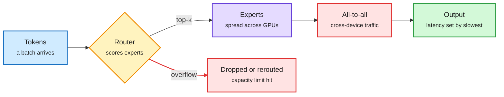

# MoE routing is a load-balancing problem first

## TL;DR

A widely shared explainer by Avi Chawla lays out seven ways a mixture-of-experts (MoE) model decides which experts process each token, and makes one point worth keeping: **an even token split does not guarantee low latency**. Experts that get small batches waste GPU time, and moving tokens between devices costs time too. The seven strategies trade routing quality against load balance and communication differently. Nothing here is new research, but it is a clean map for reading serving papers, and it lines up with the wiki's MoE serving pages.

Where the router's choice turns into latency

Selection quality is only half the job. Placement and batch size set the bill.

Blue is input, amber is the routing decision, purple is expert compute, red is the cost (drops and communication), green is the result.

## The seven strategies

| Strategy | How it picks | Trade-off |
|---|---|---|
| Token-choice | Each token takes its top-k experts | Fixed compute per token, uneven expert load |
| Expert-choice | Each expert takes its top tokens up to capacity | Balanced load, uneven compute per token |
| Dynamic | Number of experts varies per token | Router confidence is not token difficulty |
| Balanced assignment | Global matching under load limits | Some tokens miss their best expert; matching costs time |
| Hash | Deterministic hash, no learned gate | No router to train, no context adaptivity |
| Soft MoE | Experts see weighted mixtures of tokens | Changes what an expert processes |
| Group-limited | Restrict to expert groups first | If groups follow hardware placement, cuts cross-node traffic (DeepSeek-style) |

## Nearby signals the same day

- **Linear-recurrence quantization.** Christian Szegedy reposted work on quantizing the recurrences (Mamba-2, GDN, KDA) that replace attention in hybrid models. Only the opening line was captured; treat it as a pointer until the paper is read.
- **Nebius** reported +1.13% training throughput on 192 B300s running DeepSeek V3 (an MoE) from one software change.

## Relation to prior wiki pages

- **Confirms** [MoE decode batch fragmentation (09-19)](../hardware/2026-09-19-moe-decode-batch-fragmentation.md): small per-expert batches, not FLOPs, set decode cost.
- **Connects** to [fused MoE on Hopper (10-14)](../hardware/2026-10-14-fused-moe-hopper-and-batch-invariance.md) and [column-major MoE kernels (11-02)](../hardware/2026-11-02-moe-column-major-kernels-and-gpu-notebook.md), which attack the same cost from the kernel side.
- **Companion** to Hugging Face's MoE training handbook, covered in [the open MoE wave (11-06)](../llms-foundation-models/2026-11-06-inkling-2-small-and-open-moe-wave.md), which reported that up to half a training step goes to all-to-all communication.
