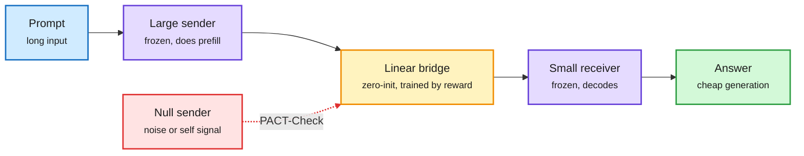

# PACT: does the small model actually use the big model's prefill?

## TL;DR

**Prefill-to-Autoregressive Cross-model Transfer (PACT)** is a way to split inference between two models. A large "sender" model reads the prompt (the prefill), and its internal representations are passed to a small "receiver" model, which does the cheap token-by-token generation. The idea is capability of the big model at close to the decode cost of the small one. This paper ([arXiv 2611.06976](https://arxiv.org/abs/2611.06976)) builds **PLatour**, an open framework that joins two frozen models with lightweight, zero-initialized linear bridges trained on task rewards, including hybrid-attention models. PLatour beats open baselines and Mostik's reported math and coding results with a much smaller sender. Then the paper turns on its own field: controlled experiments show some gains can be reproduced with **uninformative sender signals, self-communication, or receiver-only training**. The bridges can act as parameter-efficient fine-tuning of the receiver rather than as communication. The authors propose **PACT-Check** to measure how much of a gain truly comes from the sender.

The bridge might be learning, not listening

PACT-Check asks whether the gain survives when the sender's signal is replaced by noise.

Blue is input, purple is the frozen models, amber is the trained bridge, green is output, red is the control that tests the claim.

## Relation to prior wiki pages

- **Same family as** [prefill-free cross-family KV transfer (10-02)](../../raw/huggingface/2026-10-02-prefill-free-cross-family-kv-cache-transfer-for-heterogeneou.md), which moves KV cache between model families, and [disaggregated quantization (09-28)](../../raw/huggingface/2026-09-28-disaggregated-quantization-specializing-llm-prefill-and-deco.md), which specializes prefill and decode. All three treat prefill and decode as separable jobs that can run on different models or precisions.
- **Methodological warning that applies wider.** The same confound (a trainable adapter that improves the receiver on its own) could inflate other latent-communication and multi-agent "message passing" results. PACT-Check is a reusable ablation.
- Concept page: [KV cache](kv-cache.md).

## Gaps

The abstract does not give the cost model (sender prefill plus bridge plus receiver decode vs a mid-size model alone), which is what decides whether PACT is worth serving.
