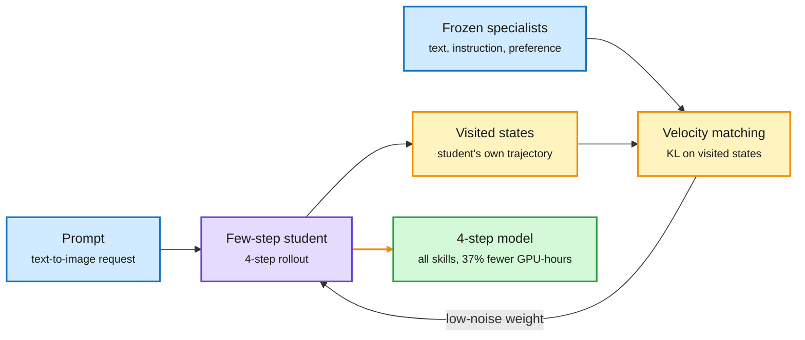

# StepX-OPD: one student learns every skill and few-step sampling at once

**TL;DR.** A production text-to-image model needs several skills (instruction following, text rendering, human preference) and must sample in a few steps. Today those are built in two stages: multi-teacher on-policy distillation (OPD, where the student is supervised on states its own rollouts visit) first merges the skills into a full-step model, then step distillation compresses that model to a few steps. The authors find every full-step model loses score once compressed, and stage two cannot start until stage one ends. StepX-OPD merges the stages: frozen specialist teachers supervise a few-step student on the states its own short rollout visits. On SD3.5-Medium and FLUX.1-dev, four-step StepX-OPD gets the best normalized score among four-step methods and beats the forty-step Flow-OPD model, with about 37% fewer GPU-hours on SD3.5-Medium than the sequential pipeline.

Teachers grade the short rollout the student actually runs

The old pipeline distills twice; StepX-OPD distills once, on the few-step trajectory.

Blue is input and teachers, purple is the student, amber is the on-policy supervision loop, green is the deployable result.

## Key points

- **The two-stage pipeline leaks quality.** Every full-step model the authors tested scores lower after step distillation, so capability work is partly lost at compression time.
- **Supervise the trajectory the student runs.** Teachers grade the states the four-step student visits, not a long forty-step trajectory it will never run in deployment. This is the on-policy argument applied to the number of steps.
- **Weight the clean end.** Decomposing the rollout KL shows velocity mismatch matters most near the low-noise end, so the student also regresses its velocity on that part of the rollout.
- **A side effect of merging skills.** Integrating a text-rendering teacher makes models write prompt words into images that never asked for text. A variant reduces this.
- **Results.** Best normalized average among four-step methods on both SD3.5-Medium and FLUX.1-dev, above the forty-step Flow-OPD model, about 37% fewer GPU-hours than DiffusionOPD followed by step distillation.

## Relation to prior wiki pages

- **Extends the OPD cost story.** The [OPD vs GRPO page](2026-11-09-opd-vs-grpo-compute-and-weight-memory.md) found distillation is only cheap when the teacher is close to the student. StepX-OPD's frozen specialists are domain teachers of the same family, the cheap regime.
- **Confirms "compress where you deploy".** Like the Extrapolation Cliff result (05-14, which found a teacher-student gap threshold above which on-policy distillation collapses), StepX-OPD shows the student should be supervised in its own operating regime, here four steps rather than forty.
- **Diffusion-only so far.** Whether the same merge works for LLMs (skill distillation plus reasoning-length compression in one stage) is untested.

Concept page: [knowledge-distillation](knowledge-distillation.md).
