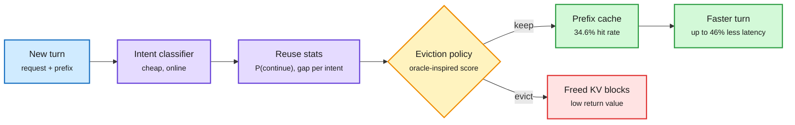

# Intent-Aware Caching (IAC)

**TL;DR.** Prefix caching keeps the KV states of earlier conversation turns so the next turn skips prefill. The hit rate depends on two unknowns: whether the user sends another turn, and how soon. IAC ([arXiv 2611.09715](https://arxiv.org/abs/2611.09715)) observes from real logs that user *intent* (coding, writing, quick question) predicts both. It classifies each request's intent online, learns lightweight per-intent continuation probabilities and inter-turn delays from recent serving logs, and feeds them to an eviction policy that approximates the offline-optimal (Belady-style) choice. On WildChat and ShareChat traces it reaches a 34.6% hit rate against 18.8% for the prior learned policy and 12.2% for LRU, cutting average serving latency by up to 46.1%.

Evict the conversation least likely to return soonest

Intent is a cheap proxy for next-turn probability and gap, which LRU cannot see.

Blue is the request, purple is the learned signal, amber is the eviction decision, green is the reused cache, red is what gets evicted.

## Key points
- Hit rate nearly triples over LRU (12.2% to 34.6%) and nearly doubles the prior learned policy (18.8%).
- The stats are learned from recent logs online, so they track shifts in traffic mix.
- Intent is a semantic signal; standard caches only use recency and frequency.

## Relation to prior wiki
- **Confirms** Arena's cache-economics finding ([10-31](2026-10-31-glance-reranker-and-cache-economics.md)): without caching a top agent task costs 3.6x, and one cache expiry adds ~5%. Eviction quality is a direct dollar lever.
- **Complements** the SIMPLE Law ([11-06](2026-11-06-simple-law-energy-cost-inference.md)), which showed caching removes 93% of prefill energy. IAC raises how often that saving applies.
- **Tension** with Google's cost-per-task routing post ([11-04](../ai-routing/2026-11-04-google-cost-per-task-classifier-routing.md)): caches are per-model, so a router that moves a conversation to another model throws away the hit IAC tried to protect. Intent is also a routing feature. A joint router-plus-cache policy is the obvious next paper.

## Gaps
Chat traces only, not agent traces (where the next turn arrives in seconds and almost always). No interaction with paged block fragmentation (NVIDIA's 11-02 point that freeing slots does not free blocks). Classifier cost and misclassification under adversarial or mixed-intent sessions are not studied.

## Research angle
Agent workloads have near-certain continuation, so intent matters less than *which tool call is next*. A version that predicts reuse from the agent's plan rather than user intent would test whether the idea generalizes. Joint optimization with model routing is open.

Concept pages: [KV cache](kv-cache.md) · [LLM routing](../ai-routing/llm-routing.md)
