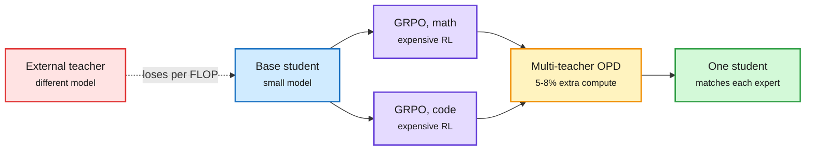

# OPD vs GRPO compute, and weight memory via self-distillation

## Unpacking the Compute Efficiency of Strong-to-Weak OPD against GRPO (Salesforce)
[arXiv 2611.08453](https://arxiv.org/abs/2611.08453). On-policy distillation (OPD: the student samples its own answers and a frozen teacher grades every token) has a much denser signal than RL's one reward per answer. Does that buy fewer training FLOPs? The answer depends on the teacher.
- **External post-trained teacher:** OPD generally *loses* to GRPO (group-relative RL) on accuracy per training FLOP, even when the teacher was itself trained with GRPO, and responses get longer.
- **Teacher = the student's own GRPO checkpoint:** OPD recovers that checkpoint's math accuracy with **50x fewer** FLOPs than GRPO needs. Holds for a larger student, on code, and in a second model family.
- **Single domain:** pointless, the GRPO checkpoint is already the model.
- **Multi-domain:** multi-teacher OPD (DeepSeek's recipe) merges per-domain GRPO experts into one student matching each expert, with the distillation stage costing 5.2-8.0% of specialist compute and ~42% fewer total FLOPs than joint GRPO.

Distillation is cheap only when the teacher already shares the student's distribution

RL finds the capability; OPD is the cheap way to merge and move it.

Blue is the starting model, purple is RL specialists, amber is the merge step, green is the result, red is the expensive path.

## Route to Remember (Amazon)
[arXiv 2611.05636](https://arxiv.org/abs/2611.05636). Text memory costs tokens on every query and grows with history. Weight memory answers with no context. On-policy *self*-distillation (OPSD) trains a context-free student from the same model conditioned on the user's memory. On HaluMem-Long, 59.9% recall vs 36.9% for plain fine-tuning and above retrieval baselines (47.8-51.9%), at 4B, 9B and 27B. A verify-then-regenerate router that checks against the text store adds 6.2 points. Weak spots: older facts fade, and the model cannot tell when a fact was never recorded.

## Relation to prior wiki
- **Refines** the 2026 OPD wave in [knowledge distillation](knowledge-distillation.md) (TIP, OPRD, the Extrapolation Cliff work): OPD's efficiency is a property of teacher-student *proximity*, not of dense supervision alone. The Extrapolation Cliff paper (05-14) found a threshold above which OPD collapses; this paper gives the compute face of the same gap.
- **Same window:** StepX-OPD (diffusion, [shorts](2026-11-09-efficiency-and-agent-shorts.md)) also merges specialist teachers on-policy and saves ~37% GPU-hours. HuggingFace TRL shipped multi-teacher OPD the same weekend. Three signals in one window that "RL specialists, then OPD merge" is becoming the default post-training stack.
- Route to Remember is the parametric-memory counterpart to [parametric context internalization](parametric-context-internalization.md).

Concept pages: [knowledge distillation](knowledge-distillation.md) · [agent memory](../agentic-systems/agent-memory.md)
