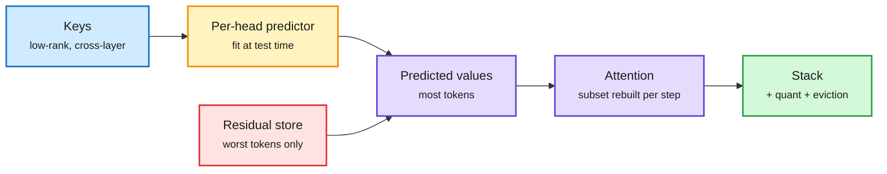

# LowRAM: predict values from keys, store only the misses

**Date:** 2026-11-10 · **Source:** HuggingFace Daily Papers 11-09 ([arXiv 2611.07025](https://arxiv.org/abs/2611.07025)) · raw: `raw/huggingface/2026-11-09-lowram-low-rank-keys-and-amortised-values-for-composable-kv.md`

## TL;DR

KV cache compression has mostly worked on three axes: drop tokens (eviction), share across layers, or lower precision (quantization). LowRAM adds a fourth. Within one attention head, a token's value vector is largely predictable from its key vector. So LowRAM fits a small per-head predictor at test time, regenerates values from keys, and stores exact residuals only for the tokens the predictor reconstructs worst. That gives about 4x near-lossless value compression. Keys get cross-layer low-rank compression. Because only a chosen subset of KV pairs is rebuilt at each decode step, decode overhead stays small, and peak decode throughput rises up to 5x at 4x compression. Stacked with quantization and eviction, it reaches 26.9x compression at 94.5% of baseline on long-context tasks.

Values are mostly a function of keys

Only the tokens the predictor gets wrong keep their own value vector.

Blue is the stored keys, amber is the learned predictor, red is the residual cost, purple is attention, green is the composed result.

## Key points

- **Asymmetry is the idea.** Keys and values are treated as structurally different objects: keys get low-rank compression, values get amortised prediction.
- **Prefill cost** is the price. The predictor can be meta-learned for a cheap init, or fitted from scratch when the cost is paid once (multi-query over one long document).
- **Composable.** It stacks with quantization and eviction instead of competing with them: 26.9x total at 94.5% quality.
- **Throughput:** up to 5x peak decode throughput at 4x compression, because the freed memory turns into batch size.

## Relation to prior wiki pages

- **Fills a gap** in the [KV cache](kv-cache.md) concept page, which so far had token, layer, head and precision axes but no "predict one half of the cache from the other" axis.
- **Confirms** the 11-06 framing that the KV term has a closed-form cost and the cache keeps shrinking. LowRAM's 26.9x stack is the largest composed ratio in the wiki this month.
- **Contrast** with 11-09 Intent-Aware Caching (evict whole conversations by predicted return): IAC decides *which sessions* to keep, LowRAM decides *how small* a kept session can be. They multiply.

## Gaps

No serving-engine integration (vLLM/SGLang paged layout) is described in the abstract. The per-step rebuild needs a custom kernel to realize the throughput. Results across "three model families" do not name the largest model tested.
