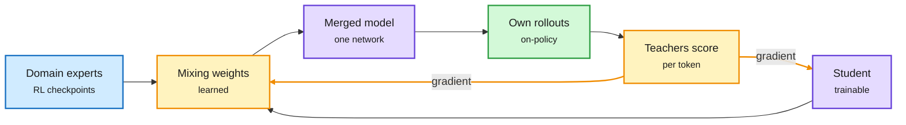

# P²-MOPD, AutoCompress and HiRes: three ways to spend fewer FLOPs on the same skill

**Date:** 2026-11-10 · **Sources:** HuggingFace Daily Papers 11-09: P²-MOPD ([arXiv 2611.03953](https://arxiv.org/abs/2611.03953)), AutoCompress ([arXiv 2611.08290](https://arxiv.org/abs/2611.08290)), Hierarchical Residuals ([arXiv 2610.41711](https://arxiv.org/abs/2610.41711)), TOPSD ([arXiv 2611.08179](https://arxiv.org/abs/2611.08179)) · raw: `raw/huggingface/2026-11-09-p-2-mopd-*.md`, `raw/huggingface/2026-11-09-autocompress-*.md`, `raw/huggingface/2026-11-09-hierarchical-residuals-*.md`

## TL;DR

- **P²-MOPD** (multi-teacher on-policy distillation with parameter priors). Multi-teacher OPD trains one student on its own rollouts, scored token by token by several domain-expert teachers. Task arithmetic (merging weights linearly) is free but stuck inside the span of the frozen models. P²-MOPD treats "student + mixing coefficients × experts" as one differentiable model and trains the coefficients and the student together under the OPD loss. Experts become priors, not a cage. At 1.7B and 4B over four domains, it passes plain MOPD's final recovery in half the steps. The 1.7B ends at 94.7% average recovery vs 80.9%.
- **AutoCompress** (NVIDIA-adjacent, hardware-guided pruning). Parameter count does not predict latency, throughput or memory. AutoCompress puts serving-engine cost models (validated against real latency, throughput and memory) into a differentiable architecture search, so each layer is pruned differently for the target GPU and workload. Over Minitron pruning: +6.57 points average accuracy on RTX 5070, +2.35 on RTX 5080, +0.57 on H100. It cut Nemotron 3.5 Super from 120B to 74B to fit one B200 in BF16 at 128K context, keeping 95% of its mean score.
- **HiRes** (hierarchical residuals). Widen the residual stream between blocks of layers (a D-wide PostNorm outer path) while every layer still computes at width d. Learned read/write projections bridge the two. Fitted scaling laws show 1.30x FLOPs efficiency. On OLMoE-1B-7B for 500B tokens: 0.0208 lower loss, +1.14 points downstream, less activation memory and I/O than mHC or AttnRes, and no custom kernels.
- **TOPSD** (teachable on-policy self-distillation). In multilingual OPSD the "teacher" (the same model given the reference answer) starts following the student's mistakes, earlier in low-resource languages. TOPSD estimates where this teacher drift begins from teacher-student likelihood and only distills prefixes the teacher can still recover from.

Experts become a starting point the student can leave

Task arithmetic stays in the span; P²-MOPD learns the mix and keeps training.

Blue is the frozen experts, purple is the trainable model, amber is the learned mixing and the teacher signal, green is the student's own samples.

## Relation to prior wiki pages

- **Gap-filling:** the 11-09 OPD-vs-GRPO paper (on-policy distillation beats RL per FLOP only when the teacher is the student's own RL checkpoint; merging per-domain RL experts costs 5-8% of specialist FLOPs) left open how to make that merge stage faster. P²-MOPD halves it. NVIDIA's Nemotron 3.5 Super VL card (same day) lists "multi-teacher on-policy distillation" as a standard training stage, so this is now production practice.
- **Pruning:** AutoCompress extends the [model-pruning-sparsity](model-pruning-sparsity.md) thread from "how many parameters" to "which shape fits this GPU." It is the first wiki result that prunes against a serving-engine cost model rather than a parameter target.
- **Architecture:** HiRes joins mHC and AttnRes in the residual-expansion family flagged in Raschka's 05-17 architecture survey; its pitch is the same gain with standard operators only.
- Concept: [knowledge-distillation](knowledge-distillation.md).

## Gaps

P²-MOPD stops at 4B and four domains. AutoCompress's H100 gain is small (+0.57), so the method matters most on memory-tight consumer cards. HiRes has one MoE pretraining run at 1B active.
