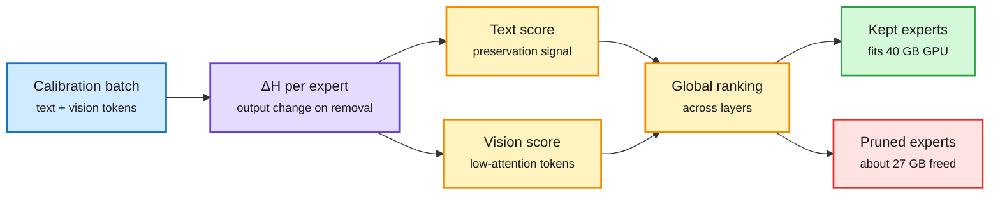

# MAEP: modality-aware expert pruning

## TL;DR

In MoE (mixture-of-experts: each token is routed to a few of many expert sub-networks) multimodal models, the experts are over 90% of the weights even though only a few run per token. InternVL3.5-30B-A3B and Qwen3-VL-30B-A3B carry about 54 GB of expert weights out of about 58 GB in BF16. Expert pruning deletes whole experts, but existing methods average importance over all tokens. The same expert can matter for language and be idle for vision. MAEP scores each expert separately for text and vision tokens in one forward pass. Its ΔH metric measures how much the MoE layer's output changes when an expert is removed, accounting for the router redistributing weight to the survivors. Vision-side importance is measured on low-attention vision tokens, which gives a ranking that stays stable across datasets. Text importance is used to protect experts, vision importance to choose which to cut, and experts are ranked globally across layers. Cutting about 27 GB (about 47% of total memory) lets the whole model fit on a single 40 GB GPU. It beats modality-agnostic baselines on most multimodal benchmarks and stays competitive on text-only ones.

Text protects an expert, vision condemns it

Two importance scores per expert, from one forward pass, ranked across all layers.

Blue is calibration data, purple is the measurement, amber is the two signals and the ranking, green is kept, red is cut.

## Relation to prior wiki

- **Extends the expert-pruning line on the [pruning concept page](model-pruning-sparsity.md)**, where REAP (router-weighted expert activation pruning) and MoNE are the text-only references. vLLM's compression office hours on 11-12 cover REAP and MoNE, so modality-aware scoring is the obvious next ask for LLM Compressor.
- **Second redistribution-aware metric in two months.** Plain activation-frequency pruning ignores that the router re-routes to survivors; ΔH measures post-redistribution output change directly.

## Gaps

Three models, all around 30B-A3B. No latency or throughput numbers, only memory. No comparison against quantizing the experts to 4-bit instead, which would free similar memory without deleting capacity.

## Links

- Paper: [arXiv 2611.05927](https://arxiv.org/abs/2611.05927) · Code: github.com/nota-github/MAEP
