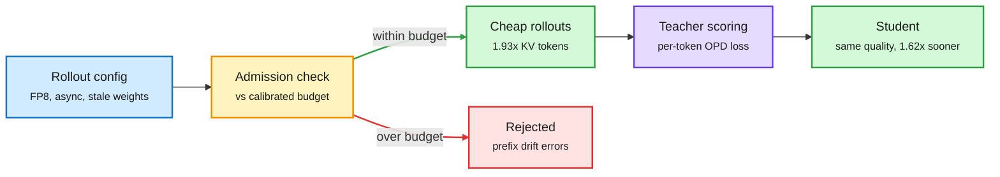

# The OPD mismatch budget

## TL;DR

On-policy distillation (OPD: the student generates its own answers and a fixed teacher scores them token by token) is expensive because of the rollouts. Systems cut that cost with quantized rollout engines and asynchronous rollouts from slightly stale weights. Both create training-inference mismatch: the engine that sampled the tokens is not exactly the model being trained. In RL this mismatch is known to destabilize training. This paper measures every mismatch source on one scale and finds OPD tolerates a lot of it. There is an empirical "mismatch budget": below it quality is unchanged, above it quality degrades. Some layers are much more precision-sensitive than others, so the budget is model-specific. Under rollout settings that break RL methods, OPD stays stable. A lightweight admission check screens a rollout configuration against the calibrated budget without a full training run. Model-specific FP8 recipes keep training quality while fitting at least 1.93x as many KV-cache tokens as BF16, and FP8 plus async rollouts reach the same quality 1.62x sooner than synchronous BF16.

Cheap rollouts are fine until you spend the budget

The admission check is the new box: it prices a rollout config before you train on it.

Blue is the config, amber is the gate, purple is the teacher, green is what passes, red is what the budget rejects.

## Key findings

- OPD tolerates substantial mismatch from quantization, weight staleness and injected noise, then degrades beyond a threshold.
- The cost of mismatch, and the mismatch quantization introduces, both depend on the model. A few layers carry most of the precision sensitivity.
- Under weight noise, mismatch shifts which prefixes the student reaches during generation. Per-token importance corrections cannot fix that, because the error is in the state distribution, not the token probabilities.
- FP8 rollouts: ≥1.93x KV-cache capacity vs BF16 at equal quality. FP8 + async: same quality 1.62x sooner. Code: github.com/benyucong/train-inference-mismatch-opd.

## Two DAIR picks from the same week sharpen it

- **Learning Dynamics of OPD** ([2611.08016](https://arxiv.org/abs/2611.08016), Oxford/EPFL/CityU) splits OPD into "conversion" (teacher signal becomes a parameter update) and "broadcast" (that update spreads across prefixes and changes what the student samples next). Updates that improve local agreement with the teacher can raise the probability of failing continuations, so the student sees worse supervision later. A short offline-distillation warm-up fixes it even without an immediate accuracy gain. This is the same prefix-drift mechanism the mismatch paper finds under weight noise, reached from the optimization side.
- **D²-OPD** ([2611.07241](https://arxiv.org/abs/2611.07241), Columbia/AWS/Amazon AGI) handles extrapolative OPD (pushing the target past the teacher along the teacher's post-training shift). It separates the target's direction from its distance with a per-prefix hard KL bound. Qwen3-8B to Qwen3-4B-Base averages 47.19 on AIME24/25 and AMC23, vs 27.57 for OPD. Qwen3 and math only.

## Relation to prior wiki

- **Answers part of the 11-09 question** from [OPD vs GRPO compute](2026-11-09-opd-vs-grpo-compute-and-weight-memory.md), which found OPD cheaper than GRPO when a strong teacher exists. This paper shows OPD's rollout side can also be quantized and made async more aggressively than RL's, widening that compute gap.
- **Echoes the Extrapolation Cliff paper (05-14)**, which found a closed-form threshold above which OPD collapses. Today's mismatch budget is the systems analogue: a measurable threshold for rollout infidelity. D²-OPD's distance bound is a third threshold, on how far the target may move.
- Updates [knowledge distillation](knowledge-distillation.md) and [quantization](quantization.md).

## Gaps

Mismatch tests on staleness and noise use one student-teacher pair. No result above mid-size models. The admission check is calibrated per model, so its transfer across families is untested.

## Links

- Paper: [arXiv 2611.11450](https://arxiv.org/abs/2611.11450)
