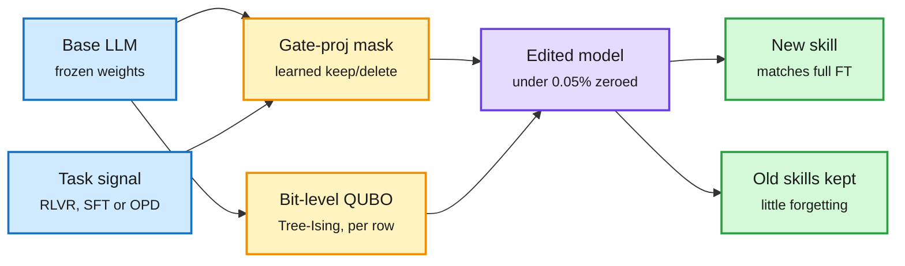

# Deletion Tuning and Tree-Ising

## TL;DR

**Deletion Tuning** (2611.10866, NeurIPS 2026) asks how little of a pretrained LLM must change for it to learn a new skill. Its answer: zero fewer than 0.05% of the weights and change nothing else. It learns a binary keep/delete mask over the gate projection of each transformer block's MLP. That alone matches full fine-tuning (FFT) at scale across RLVR (reinforcement learning with verifiable rewards), SFT and on-policy distillation. The trained mask is hundreds to thousands of times smaller than an FFT checkpoint. It also forgets far less: under RL, prior-task accuracy stays near the base model while FFT, LoRA and random sparse fine-tuning lose up to 5.4 points. Geometry checks (stable rank, spectrum drift, overlap with principal weights) put the mask's effective update closer to FFT than LoRA's. **Tree-Ising** (2611.14210) goes one step further and edits individual bits. It repairs a model's reasoning loops by casting the edit as a QUBO (a quadratic binary optimization, the form an Ising solver handles) over sign flips and exponent shifts of the model's own BF16 weights, one independent problem per output row, solved by GPU simulated annealing. On Qwen3.5-0.8B it reaches 54.6% on MATH-500 against 51.7% for a GPT-6 Astra agent's hand-written repair (base model 7.9%), with four forward passes, zero LLM tokens and about $0.90 of GPU time; on Qwen3.5-2B it lifts greedy GSM8K from 21.6% to 69.4%.

The skill was already in the weights; you only switch some off

Deletion Tuning trains a mask, not weights. Tree-Ising flips bits. Neither runs a gradient update on the weights themselves.

Blue is input, amber is the edit search (mask or bit QUBO), purple is the edited model, green is what you get.

## Key points

- **Storage:** a mask over gate projections costs bits, not a second copy of the model. Per-skill adapters become tiny, which matters for multi-tenant serving of many fine-tunes.
- **Forgetting:** the continual-learning angle is the strongest claim. Prior-task accuracy holds near base under RL where FFT, LoRA and random sparse masks drop up to 5.4 points.
- **Tree-Ising cost:** edits 13-17% fewer weights than the agent's repair and cuts BF16 bit flips 2.2-2.3x. An eight-variable subproblem was also run with QAOA on an IBM Heron processor (proof of concept only).
- **Social version:** a practitioner wrote a decision skill directly into Qwen3.5-0.8B weights from a decision engine's answers, with no dataset and no training ([@Nandakishorm1](https://x.com/Nandakishorm1/status/2120435924756791433)); another team runs weight edits in a propose-score-keep loop ([@_matt_winters](https://x.com/_matt_winters/status/2120595027999039640)).

## Relation to prior wiki pages

- **N-of-a-kind (three in a week):** Weight-Space Programming (MIT, 2611.09382, noted 11-10: a frontier agent reads a network's weights and writes a repair without gradients), Lazarus (11-11: fewer than 10 dormant neurons reprogrammed to plant an agent backdoor, no training) and now Deletion Tuning plus Tree-Ising. All four change a tiny, targeted slice of weights with no conventional training loop. The pattern: post-training capability is sparse and locatable.
- **Double edge:** the same sparsity that makes Deletion Tuning cheap is what makes Lazarus hard to detect. Provenance checks must look at sparse diffs, not loss curves.
- **Extends** the 11-10 AutoCompress / pruning-to-a-GPU thread: pruning is usually framed as compression; Deletion Tuning frames it as learning.
- **Gaps:** Deletion Tuning's "at scale" needs the paper's largest size checked; whether masks compose across many skills without collision is not shown. Tree-Ising only repairs a known failure direction (looping); it is not a general training method.

Concept pages: [model pruning and sparsity](model-pruning-sparsity.md), [knowledge distillation](knowledge-distillation.md).
