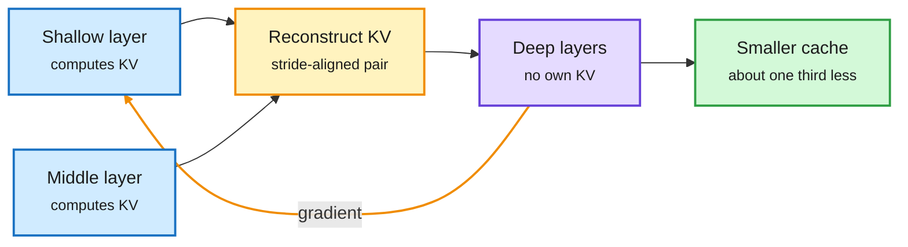

# DepthGraft and Weighted State Souping

## TL;DR

**DepthGraft** (2611.03142) revisits cross-layer KV sharing, where deep layers reuse keys and values computed by earlier layers instead of storing their own. That is usually sold as cache compression. DepthGraft argues it is also a regularizer: every reuse edge gives a direct gradient path from deep layers back to the source layer's KV projections, which sharpens key retrieval directions and enriches value content. Adjacent-layer and single-anchor sharing do not exploit this well. DepthGraft rebuilds deep-layer KV from stride-aligned pairs of shallow and middle source layers, spreading that gradient flow. It keeps early prefill completion (upper layers need no prompt pass of their own), cuts the KV cache by about a third, and improves downstream accuracy from 0.5B to 16B under both GQA and MLA. The 16B MoE gains 7.0 points on MMLU-Pro, 6.6 on CMMLU and 6.4 on C3. **Apple's Weighted State Souping** applies the cache-and-recombine idea to state space models (SSMs, recurrent models with a fixed-size state instead of a growing KV cache). State souping encodes chunks such as documents, tool definitions or memory records independently, caches each final state, and mixes them for a query. It degrades on crowded contexts. Learning query-dependent mixing weights fixes much of that across multi-hop QA, needle retrieval, variable tracking and tool use, and a sparse variant keeps encoding cost near constant in context length. A companion Apple paper finds the gating mechanism in SSMs pushes them to memorize in weights first, delaying or preventing the in-context-learning solution, even when capacity is not the limit.

Share the cache, gain a gradient path

DepthGraft's deep layers read KV built from two earlier layers. Compression and better training come from the same edge.

Blue is the source layers, amber is the reconstruction and the gradient path it opens, purple is the deep stack, green is the cache saving.

## Relation to prior wiki pages

- **Same family as RidgeFill (11-11),** which fills upper-layer KV at inference from a ridge-regression prediction with no training. DepthGraft is the trained, architectural version of the same bet: upper layers do not need their own view of the prompt. Together with YOCO-style and DeepSeek-V4.1-Flash cross-layer designs, that is now a well-populated direction.
- **Contradicts a framing:** the kv-cache page has treated cross-layer sharing as an accuracy cost paid for memory. DepthGraft claims a net accuracy gain. That needs a matched-compute check before the page treats it as settled.
- **State souping is the SSM analog of prefix caching:** reusable per-document states are the recurrent version of cached KV blocks, relevant to agent workloads with many tool definitions.
- **Gaps:** DepthGraft's largest run is 16B; the 7-point MMLU-Pro gain is unusually large for an architectural tweak. State souping results are workshop-scale.

Concept pages: [KV cache](kv-cache.md), [attention mechanisms](../llms-foundation-models/attention-mechanisms.md).
