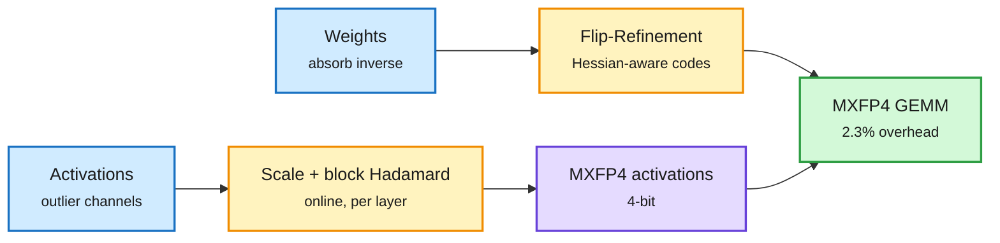

# MACaQ and Kimi K3.1 Pro NVFP4

## TL;DR

**MACaQ** (2611.10649) is an MXFP4 W4A4 post-training quantization method (4-bit weights and 4-bit activations in the microscaling FP4 format) that treats every linear layer on its own. Recent W4A4 methods rotate activations to spread outliers, but they propagate the rotation across layers, which needs architecture-specific code and costly optimization. MACaQ instead applies a per-channel scale and a block-Hadamard transform to each layer's activations online, at inference, and absorbs the inverse into that layer's weights. Because nothing crosses layer boundaries, quantization streams one layer at a time: a 122B model quantizes in 64 minutes in 32.5 GB of GPU memory. Rounding is improved by **Flip-Refinement**, a Hessian-aware coordinate descent that nudges individual FP4 codes to neighbouring values. Runtime overhead of the online transforms is 2.3% end to end over plain MXFP4 on Qwen3-32B in vLLM. It beats DuQuant++ and MR-GPTQ on perplexity and matches their best Llama-3-8B result 11x faster, and it works unchanged on an image diffusion model. Same window, NVIDIA published **Kimi K3.1 Pro NVFP4** (2.8T total, 104B active MoE, 1M context): routed experts converted MXFP4 to NVFP4, shared experts and the KDA attention in MXFP8, MLA layers kept in BF16. Scores stay within about 0.4 points of the MXFP4 source on GPQA Diamond, AA-LCR, IFBench, MMMU Pro, SciCode and Terminal-Bench 2.1.

Rotate inside each layer, never across layers

The inverse transform lives in the weights, so each layer quantizes alone and only one layer sits in memory.

Blue is the tensor coming in, amber is the MACaQ step, purple is the quantized activation, green is the low-precision matmul.

## Key points

- **Why layer-local matters:** cross-layer rotation methods (QuaRot/SpinQuant style) need per-architecture plumbing; MoE, hybrid attention and diffusion models each break it. MACaQ trades a small online cost for "works on anything with linear layers".
- **Streaming quantization** (one layer resident) is what lets a 122B model quantize on a single 40 GB-class GPU.
- **NVIDIA's mixed recipe** is the production counterpart: 4-bit where parameters are many and robust (routed experts), 8-bit for shared experts and linear attention, BF16 for the sensitive MLA layers. Served on Blackwell via vLLM with TP=8 at 1M context.

## Relation to prior wiki pages

- **Extends** the 11-11 OPD mismatch result (FP8 rollouts in on-policy distillation keep quality, and a few layers carry most precision sensitivity). NVIDIA's card is a second, independent instance of "keep a few layers high precision" applied at 2.8T scale.
- **Confirms** the 11-10 hybrid MoE NVFP4 short read: FP4 is now the default release format for frontier-scale open MoEs on Blackwell.
- **Gaps:** MACaQ reports perplexity and a few downstream tasks; long-context and reasoning-trace accuracy at W4A4 are not shown. NVIDIA's card gives no throughput number.

Concept page: [quantization](quantization.md).
