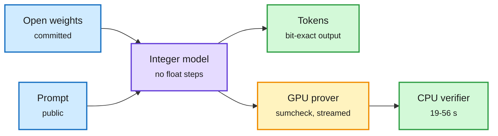

# Sable: bit-exact verifiable inference

## TL;DR

Sable (2611.14083) is an argument system plus a single-GPU prover for one statement: this committed, integer-quantized transformer produced this token sequence from this prompt, bit for bit. To make that statement provable it defines an integer-only version of the model (F_O) in which every rounding, normalization, softmax and sampling step is fixed by its inputs, with no floating point. The proof uses sumcheck over the 31-bit KoalaBear field with constraints that provably never wrap, and one multilinear commitment over all weights and intermediate tensors. The prover streams the model layer by layer. On one RTX PRO 6000 Blackwell it proves all 64 layers of Qwen2.5-32B in 92.5 s for 4,096 tokens (398 s for 16K), Qwen3-32B in 121.8 s and the MoE Qwen3-30B-A3B in 84.7 s. A proof costs 41-50x the serving time, about 6.4 cents per 4K-token request at public GPU prices, and is 40-64x faster per parameter-token than zkLLM. A CPU core verifies in 19-56 s. The integer model matches BF16's greedy token at 86.3% of WikiText-2 positions and is within 1.6 points on MMLU and 1.7 on GSM8K. It is not zero-knowledge, so it targets open-weight models.

Make the model deterministic, then prove it

Quantization is not just for speed here. Integer-only inference is what makes a proof possible at all.

Blue is what is committed, purple is the integer model, amber is the proof, green is what a client receives and checks.

## Relation to prior wiki pages

- **Answers a question raised 11-11:** after Lazarus (a backdoor planted in fewer than 10 neurons), the wiki asked how a client could know which weights served them. Sable proves the output came from a committed weight file. It does not prove those weights are clean, so it complements rather than replaces a dormant-neuron scan.
- **Connects to Signed but Steerable (11-08)**, which found float and dynamic-INT8 embedding pipelines are not bit-reproducible across batch sizes; Sable's fix is the same idea taken to the full model: canonical integer arithmetic.
- **Kimi Vendor Verifier (same window, NVIDIA's NVFP4 card)** is the cheap statistical version of this: check a vendor's deployment against reference accuracy. Sable is the cryptographic version at 41-50x cost.
- **Gaps:** 86.3% greedy-token agreement with BF16 means the provable model is a slightly different model; proof cost is far from serving cost.

Concept page: [quantization](quantization.md).
