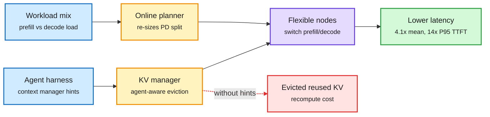

# Evolving Infra: agent-adaptive LLM serving at scale

## TL;DR

Prefill/decode (PD) disaggregation splits serving into prefill nodes (read the prompt, build the KV cache, the memory of past attention) and decode nodes (generate tokens). Today's systems fix that split and evict KV by generic signals such as recency. Agent workloads break both choices: an agent's mix of long-prompt tool returns and short decodes shifts from minute to minute, and the agent's own context manager knows which context it will reuse. Evolving Infra decouples compute allocation from KV ownership so any node can flip between prefill and decode, runs an online planner that re-sizes the PD split to the live workload mix, and adds a distributed KV manager that takes eviction and transfer hints from the agent's context management. On coding, math and computer-use agents with GLM-5.2 and Kimi K2.6 across up to 256 GB300 GPUs, it cuts mean end-to-end latency up to 4.1x and P95 time-to-first-token up to 14x against NVIDIA Dynamo.

The agent tells the cache what it will need next

Two new boxes: a planner that re-splits nodes, and a KV manager that listens to the agent.

Blue is input signal, amber is the two new control loops, purple is the serving fleet, green is the result, red is the failure mode it removes.

## Key findings

- Decoupling compute allocation from KV cache ownership is the enabling move: a node can change role without migrating every cache it holds.
- The online planner matches the PD ratio to workload composition at runtime instead of a static deploy-time ratio.
- Agent-aware eviction uses the harness's own context-management signals (what will be re-read, what was compacted) to keep KV the agent will reuse.
- Up to 4.1x mean end-to-end latency and 14x P95 TTFT over Dynamo, on 256 GB300s with two large open MoE models.

## Gaps

- Abstract only; no alphaxiv overview yet. The baseline is Dynamo, not SGLang's HiCache or LMCache-style tiered caches, which also target reuse.
- Gains depend on the harness exposing context-management hints; closed harnesses may not.
- No cost-per-token or energy figure, only latency.

## How it relates to prior wiki pages

- **Extends** the agent-serving thread in [KV cache](kv-cache.md): RidgeFill (11-11, fills late-layer KV from a cheap prediction) and DepthGraft (11-12, shares KV across layers) shrink the cache; Evolving Infra instead keeps the right cache alive. Different layer of the same problem.
- **Confirms** the [agent harness engineering](../agentic-systems/agent-harness-engineering.md) claim that the harness is becoming a serving input, not just a client.
- Same day, AWS made SGLang's PD disaggregation and KV transfer run on Trainium (SGLang-Neuron), so PD disaggregation is now a cross-vendor default and the next contest is the control plane on top of it.
