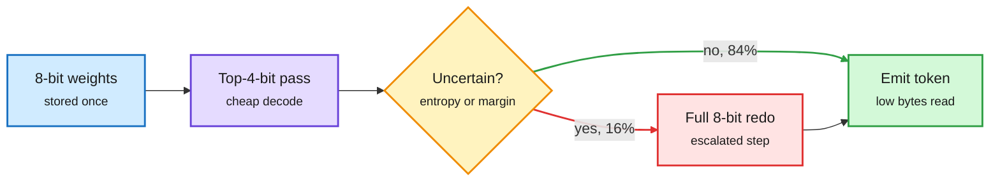

# Precision on Demand and Bits or Permutations

## TL;DR

Two small companion papers price inference in one machine-independent unit, weight bytes read times passes, and ask where to spend it on Qwen3 0.6B and 1.7B. **Precision on Demand** (2611.14418) stores 8-bit weights, decodes with only the top 4 bits, and redoes a step at 8 bits when the 4-bit output looks uncertain (high entropy or small top-two margin). The low-pass entropy ranks argmax flips with AUC 0.93; at a 15% escalation budget an entropy gate catches 78% of flips and a margin gate 94%. Live on 150 GSM8K problems, a 16% escalation rate scores 62.7% at 0.87 of all-high bytes, between all-low (55.3%) and all-high (64.0%), but the confidence intervals do not separate it from either end. **Bits or Permutations** (2611.14413) finds 6-bit round-to-nearest weights lose nothing against fp16 on four multiple-choice benchmarks, 4 bits sharply raise answer-slot skew (a bias toward one letter), and averaging four cyclic option orders recovers 12.6 points at 4 bits on 0.6B. Its decision rule: use 6-bit weights and spend the remaining budget on up to four reorderings.

Pay for 8 bits only when the 4-bit step is unsure

One weight file, two read depths; the gate decides per token.

Blue is storage, purple is the cheap pass, amber is the gate, green is the normal exit, red is the paid escalation.

## Key findings

- Low-precision uncertainty is a strong flip detector offline (AUC 0.93), so the gate idea is sound.
- Live gains are not statistically separated; the authors say so, and also list the runs they did not do (live random control, second model, live KL).
- Verified speculation reaches zero KL at similar bytes in the same cost model, so speculative decoding remains the stronger baseline.
- 6-bit is the free lunch for sub-2B models; 4-bit damage shows up as positional bias that reordering partly repairs.

## Gaps

- Simulated quantization, round-to-nearest only, two tiny models. Real kernels make mixed-depth reads harder than the byte count implies.

## How it relates to prior wiki pages

- **Extends** [test-time compute allocation](test-time-compute-allocation.md): CLEAR (one shadow price to ration compute across a batch) and the 10-29 effort-escalation page escalate between models or thinking levels; this escalates within one weight file, per token. Same "score first, then spend" idea as the decision-model wave, at the bit level.
- **Connects** to [quantization](quantization.md) and Kurate cs.AI #19 this week ("When Self-Consistency Hurts", majority voting can cost small models accuracy): both question cheap ensembling tricks on small models, with Bits or Permutations finding reordering helps only above 6 bits.
- Honest reporting of null-ish live results is rare and worth noting; treat both as hypotheses with a good offline signal.
