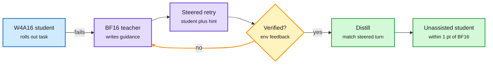

# SteerDistill: quantizing LLM agents with a steering teacher

## TL;DR

A 4-bit agent rarely fails on a single token. It fails by missing a task requirement or an environment condition, and then the whole trajectory drifts away from what the full-precision model would have done. Offline distillation data never visits those failure states, and the quantized student's own rollouts rarely contain a correct answer in them. SteerDistill fixes this with a loop: the full-precision teacher reads the student's failed turn, writes guidance, the student retries with that guidance, and the teacher refines the guidance from the execution feedback until the turn is verified correct. The student is then trained, without guidance, to match the steered student at corrected turns and the teacher everywhere else. Across five agent benchmarks and three models it beats the strongest quantized baseline by 1.67 to 2.18 points under W4A16 (4-bit weights, 16-bit activations), lands within one point of BF16, and beats QeRL on tau-squared-Bench by 1.84 points with 67% fewer training GPU hours.

Fix the turn where the 4-bit agent goes wrong, then forget the hint

The teacher never writes the answer. It steers the student until the student's own retry works.

Blue is the quantized student, purple is teacher and retry, amber is the verification loop, green is the distilled result.

## Key findings

- Failure diagnosis: quantized agents diverge in environment transitions (they overlook requirements), not in fluency.
- Corrections are locally verified by execution, so the distillation target is a turn known to work in context.
- +1.67 to +2.18 points over the best quantized baseline, within 1 point of BF16, shorter successful trajectories.
- 67% fewer training GPU hours than QeRL (quantized RL) for a better tau-squared-Bench score.

## Gaps

- W4A16 only; no W4A4 or 3-bit result, where drift should be worse.
- Requires a verifiable environment and a live teacher during training.
- Three models, sizes not given in the abstract.

## How it relates to prior wiki pages

- **Extends** [quantization](quantization.md): MACaQ (11-12, layer-local W4A4 at 2.3% runtime overhead) shrinks the model; SteerDistill repairs the behavior that shrinking breaks in multi-turn use. Together they suggest the quantization stack for agents is "compress, then behavior-distill".
- **Confirms** the [knowledge distillation](knowledge-distillation.md) pattern that on-policy, failure-state targets beat offline teacher traces (the TIP and OPRD line of work: most teacher tokens carry no signal; the useful ones sit where the student goes wrong).
