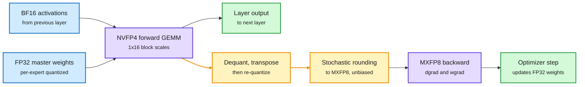

# End-to-End 4-Bit Training (Thinking Machines, Inkling 2 Small)

## TL;DR

Thinking Machines published the numerics recipe behind Inkling 2 Small, the 594B-parameter MoE (mixture-of-experts, where each token goes through a few specialist sub-networks) it open-sourced on 11-13 under Apache 2.0. It is the largest model the lab knows of trained end to end with a **native 4-bit forward pass**. The expert layers run their forward GEMMs (matrix multiplies) in NVFP4. The backward pass runs in MXFP8, using weights and activations that are de-quantized, transposed and **re-quantized with stochastic rounding** so the gradient is unbiased. Expert-parallel communication is quantized too: dispatch in NVFP4, combine in an 8-bit fixed-point format (S2F6) after a 32-dimensional random Hadamard transform. The same numerics run from the first pretraining step to the last RL rollout, so the shipped 4-bit checkpoint needs **no post-training calibration**. Result: **8% wall-clock speedup in pretraining and 20% in RL** over full MXFP8, for about a 2% compute-efficiency loss. Serving needs at least ~500 GB in NVFP4 or ~800 GB in MXFP8, and MXFP8 adds only "1-2 points" on evals.

4 bits forward, 8 bits backward, unbiased in between

The trick is the transpose: re-quantize with stochastic rounding so the backward pass sees the forward tensor in expectation.

Blue is input, purple is a GEMM, amber is the re-quantization step that removes gradient bias, green is the output.

## Key points

- **Why 4-bit at all.** On GB300 (Blackwell Ultra), NVFP4 runs at about 15 PFLOPS versus 5 for MXFP8 and 2.5 for BF16, while storing 3.6x fewer bits than BF16 (4.5 bits per value including the block scale).
- **Where to spend precision.** Forward passes in pretraining and RL sampling are high-volume, so speed matters most there. Backward passes average over many tokens, so random rounding error washes out, but they are very sensitive to **bias** (values consistently rounding one way), which compounds across layers and steps. So: 4-bit forward, 8-bit unbiased backward.
- **MoE layers only.** Expert layers are the most expensive and the least accuracy-sensitive to quantization. Full NVFP4 training (forward and backward) cost too much compute efficiency.
- **The transpose problem.** NVFP4 scales blocks of 16 values along a row. The backward pass needs the transposed tensor, which groups each value with 15 different neighbours and different scales, so many values flush to zero. NVIDIA's 16x16 tile-scale fix keeps forward and backward bit-identical but is too coarse: one outlier in 256 values zeroes the rest. Thinking Machines found it hurt compute efficiency, and instead requires only that forward and backward tensors are **equal in expectation**, which stochastic rounding provides (and Blackwell accelerates in hardware). Inspired by TetraJet-v2 and Quartet II.
- **Communication became the bottleneck.** After the GEMMs got ~3x faster, expert-parallel all-to-all over NVLink (900 GB/s per direction against 15 PFLOPS, about 16,000 FLOPs per byte received) left tensor cores idle. Dispatching tokens in NVFP4 and combining in Hadamard-rotated S2F6 8-bit removed the tail with "no measurable accuracy degradation".
- **No calibration step.** Because numerics never change between pretraining and the final RL rollout, the quantized checkpoint is the trained model, not a post-hoc approximation of it.

## Relation to prior wiki pages

- **Confirms and extends SteerDistill (11-13)**, which repaired a 4-bit *agent* after training by steering it at failed turns. Inkling takes the opposite route: never train in high precision, so there is nothing to repair. Two answers to the same question, "how do you get a 4-bit agent that behaves like full precision", one day apart.
- **Extends Precision on Demand (11-13)**, which escalated individual tokens from 4 to 8 bits at inference. Inkling applies the same split by *pass*: cheap where error averages out, careful where bias compounds.
- **Fills a gap on the [quantization](quantization.md) page**: prior entries were dominated by post-training quantization (PTQ) and quantization-aware fine-tuning. This is the first frontier-scale, fully disclosed native-FP4 pretraining recipe in the wiki.
- **Connects to [gpu-kernels](../hardware/gpu-kernels.md) and [memory-hierarchy](../hardware/memory-hierarchy.md)**: once compute is 4-bit, the NVLink byte budget becomes the constraint, the same "compute outruns the wire" pattern seen in expert-parallel serving.

## Open questions

- The 2% compute-efficiency loss is measured by the lab's own CE metric. No independent replication yet.
- Attention and dense layers stay in higher precision. Whether NVFP4 can reach attention without the outlier problem is open.
- Speedup over MXFP8 is 8% in pretraining, far below the ~3x GEMM speedup, because communication and non-expert work dominate. The ceiling depends on how much of the step is expert GEMM.
